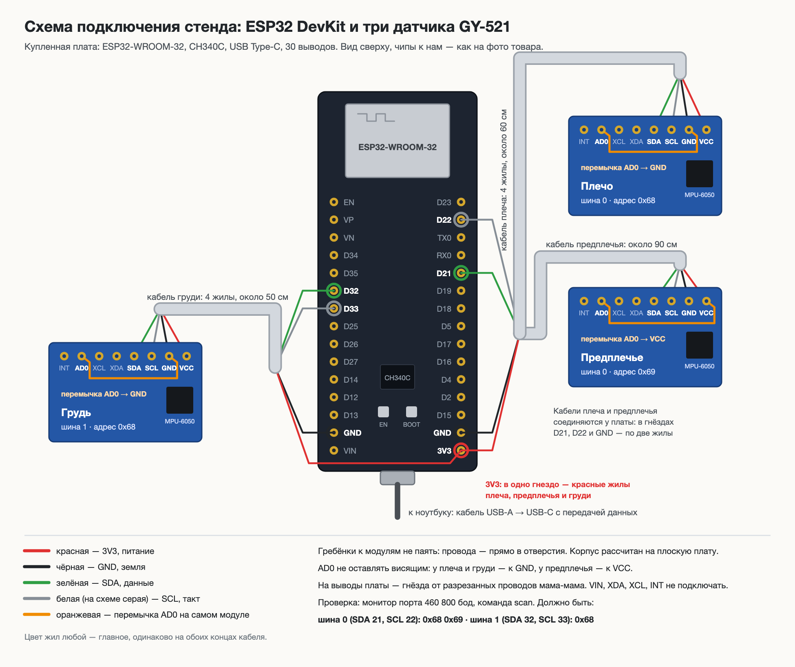

# Стенд NeuroMove — прошивка, сборка, проверка

> **Навигация:** в этой папке только прошивка ESP32, конфигурация PlatformIO и host-проверки. Схемы, сборка датчиков и корпуса вынесены в [`../hardware/`](../hardware/README.md).

Прошивка для стенда способа А ([`../прототип.md`](../прототип.md)): плата ESP32 и до трёх датчиков
MPU-6050 (модули GY-521) на проводах, поток по USB в приложение NeuroMove. Плата ничего не считает:
она 100 раз в секунду читает сырые числа с датчиков и отправляет их строкой в формате imu-csv v1
([`../софт.md`](../софт.md), раздел 1). Углы считает приложение.

**Что проверено, а что нет — честно:**

| Проверено | Как |
|---|---|
| Прошивка собирается для ESP32-S3 (порт COM и родной USB) и классического ESP32 | PlatformIO, ядро Arduino-ESP32 2.0.17 и 3.3.12 — см. «Сборка» |
| Формат, регистры MPU-6050, расписание 100 Гц, поиск датчиков, пропуски, перезапуск шины, датчик отошёл и вернулся, калибровка | 108 проверок на компьютере с поддельными датчиками: `test/run.sh` |
| Приложение читает вывод прошивки байт в байт, в том числе кусками, как из порта | `test/golden.csv` разбирает тест приложения `src/devices/firmware.test.ts` |
| Поправки калибровки убирают ошибку заводского нуля | тест приложения: без поправок до 6,5°, с поправками 0,24–0,36° (запись станка на симуляторе) |
| Купленная плата без датчиков — 12 октября, мак Амирхана | прошивка загружается, `датчиков найдено 0 из 3`, `scan` и `help` отвечают. На 921 600 бод весь вывод приходил каракулями (CH340C со встроенным драйвером macOS), на 460 800 — чистый текст: скорость порта теперь 460 800 |
| **С датчиками на настоящей плате и с приложением — не проверено** | первый запуск — по разделу 4, по шагам; подробно — [`../hardware/docs/проверка-до-пайки.md`](../hardware/docs/проверка-до-пайки.md) |
| Сборка под купленную плату — классический ESP32 (`esp32dev`, флеш 4 МБ) | 7 октября: без предупреждений, память 7%, флеш 24% |

---

## 1. Детали

| Что | Сколько | Где взять |
|---|---|---|
| ESP32 DevKit: ESP32-WROOM-32, USB-UART CH340C, USB Type-C, 30 выводов | 1 | ✅ куплена 9 октября на Kaspi, 3 498 ₸ — [`../прототип.md`](../прототип.md), раздел 2. Подойдёт и ESP32-S3 N16R8 — выводы в разделе 2 |
| GY-521 (MPU-6050) | 4: три и запасной | ✅ куплены 9 октября на Kaspi, по 882 ₸ |
| 4-жильный мягкий круглый кабель, не толще 4,6 мм | у каждого датчика свой: плечо 60 см, предплечье 90 см, грудь 50 см — около 2 м | старые USB-кабели с передачей данных: внутри 4 жилы. Плоский шлейф не ляжет в паз корпуса |
| Провода мама-мама 20 см | 1–2 упаковки по 10 | разрезать пополам: гнёзда — на выводы платы, провод — к кабелю |
| Термоусадка 2 и 6 мм, паяльник | — | паять провода прямо в отверстия модуля, без штыревого разъёма |
| Липучка 20 мм рулоном, липнет сама к себе | 5 м | ремешки; прорезь корпуса — 30 мм, шире ремешок не пройдёт |
| Корпуса | по одному на датчик | `../hardware/models/enclosure/`, раздел 7 |
| Кабель USB-A → USB-C с передачей данных | 1 | C ↔ C плату может не запитать: у дешёвых плат с Type-C часто нет резисторов на линиях CC |

**Гребёнки к модулям не паять** — кроме запасного, четвёртого модуля для проверки до пайки кабелей
(раздел 4, шаг 0б). Корпус высотой 9,2 мм рассчитан на плоскую плату: провода кабеля
паяются прямо в отверстия VCC, GND, SCL, SDA. AD0 тоже паяется на самом модуле — коротким проводом
к GND (плечо, грудь) или к VCC (предплечье): тогда в кабеле остаются 4 жилы.

**Подпишите модули маркером** («плечо», «предплечье», «грудь»). Калибровка принадлежит
конкретному модулю. Прошивка запоминает вместе с поправками отпечаток модуля — заводские значения
самопроверки чипа (регистры 0x0D–0x10): переставили или заменили модуль — стенд сам напишет
`внимание: поправки … сняты с другого модуля` и не применит их. У копий чипа отпечатка нет
(в паспорте `id_<место>=none`), для них подпись маркером — единственная защита.

## 2. Подключение

Два датчика руки висят на одних четырёх проводах шины 0 и различаются выводом AD0. Датчик груди —
на своей шине 1. Питание модулей — 3V3 платы (на GY-521 свой стабилизатор и подтяжки 4,7 кОм
на SDA и SCL — отдельные резисторы не нужны).

**У каждого датчика свой кабель** (с 22 октября): кабели плеча и предплечья соединяются у платы —
в гнёздах D21, D22 и GND по две жилы, в 3V3 — три. Раньше кабель предплечья шёл через датчик плеча,
но две жилы не влезают в отверстие модуля, а в паз корпуса входит один кабель. Сборка по шагам —
[`../hardware/docs/сборка-датчиков.md`](../hardware/docs/сборка-датчиков.md).

**Классический ESP32 DevKit — купленная плата.** Выводы в [`NeuroMoveStand/config.h`](NeuroMoveStand/config.h),
на плате они подписаны D21, D22, D32, D33.

**С 27 октября по умолчанию — три шины, по датчику на шину, все на 0x68, AD0 никуда.** Кабель к каждому
датчику — 4 жилы. Плечо — шина 0 (D21, D22), предплечье — шина 1 (D19, D18), туловище — шина 2, программная
(D16 и D17, на плате HW-394 так и подписаны, на других — RX2 и TX2; [`NeuroMoveStand/soft_i2c.h`](NeuroMoveStand/soft_i2c.h)): у ESP32 аппаратных шин
две. Стенд целиком — [`../hardware/diagrams/схема-стенда.png`](../hardware/diagrams/схема-стенда.png), разводка на макетной плате —
[`../hardware/models/enclosure/ПЕЧАТЬ-v3.md`](../hardware/models/enclosure/ПЕЧАТЬ-v3.md). Схема ниже — прежняя, две шины и AD0 у предплечья:
собрать с `#define NM_TWO_BUSES` в `config.h`.



Картинка нарисована по фото купленных плат: вид сверху, чипы к нам, у GY-521 выводы слева направо —
INT, AD0, XCL, XDA, SDA, SCL, GND, VCC. Исходник — [`../hardware/diagrams/схема-подключения.svg`](../hardware/diagrams/схема-подключения.svg),
его пишет [`../hardware/diagrams/схема-подключения.py`](../hardware/diagrams/схема-подключения.py); команда пересборки — в начале скрипта.

| Вывод GY-521 | Плечо (шина 0) | Предплечье (шина 0) | Туловище (шина 1) |
|---|---|---|---|
| VCC | 3V3 | 3V3 | 3V3 |
| GND | GND | GND | GND |
| SDA | GPIO 21 | GPIO 21 | GPIO 32 |
| SCL | GPIO 22 | GPIO 22 | GPIO 33 |
| AD0 | **GND** — адрес 0x68 | **3V3** — адрес 0x69 | **GND** — адрес 0x68 |
| XDA, XCL, INT | не подключать | не подключать | не подключать |

- **Вывод 3V3 на плате один:** красные жилы плеча, предплечья и груди паяются в одно гнездо.
  Выводов GND два: правый, рядом с 3V3, — кабели руки, левый, рядом с VIN, — грудь. VIN (5 В) не подключать.
- Ни один из выводов 21, 22, 32, 33 не влияет на загрузку платы: у классического ESP32 это 0, 2, 5, 12, 15.

**ESP32-S3 N16R8** — то же, но шина 0: SDA — GPIO 8, SCL — GPIO 9; шина 1: SDA — GPIO 4, SCL — GPIO 5.
Почему эти выводы у S3: 0, 3, 45, 46 управляют режимом загрузки; 19 и 20 — USB; 26–37 заняты флешем
и памятью PSRAM модуля N16R8; 43 и 44 — порт «COM», по нему данные идут в ноутбук.

- **AD0 не оставлять висящим:** у модуля нет надёжной подтяжки — адрес будет «плавать».
- **Кабель до 50 см**, шина на 100 кГц (`I2C_HZ` в `config.h`). Сбоит — укоротить кабель, скрутить SDA с GND
  и SCL с GND парами. Шина руки с двумя кабелями — около 1,5 м; по расчёту ёмкость шины меньше 400 пФ,
  предела I2C для 100 кГц, на плате ещё не мерено.
- **Первый этап** (прототип.md, раздел 6) — только плечо и предплечье на шине 0. Прошивка работает
  с любым набором: какой датчик нашёлся, тот и в потоке.
- Левая рука — раскомментировать `#define NM_LEFT_ARM` в `config.h`.

## 3. Сборка и прошивка платы

### Arduino IDE

1. «Менеджер плат» → **esp32** от Espressif Systems (проверено на 2.0.17 и 3.3.12).
2. Открыть `NeuroMoveStand/NeuroMoveStand.ino` — остальные файлы папки откроются вкладками.
3. «Инструменты»: плата **ESP32 Dev Module** — купленная плата. На маке загрузка обрывается —
   **Upload Speed: 460800**. **Core Debug Level: None** — так по умолчанию; иначе ядро пишет в порт
   служебные строки `[E]…`, и приложение посчитает их испорченными. Для ESP32-S3 — **ESP32S3 Dev Module**; **USB CDC On Boot: Disabled**;
   **Flash Size: 16MB**.
4. Кабель USB-A → USB-C (у S3 — в разъём **COM**). Порт — тот, что появился. «Загрузить».
   Не грузится — зажать BOOT, нажать и отпустить RESET, отпустить BOOT, загрузить снова.
   Порт не появился — кабель только для зарядки или нет драйвера CH340: на Windows его ставит
   Windows Update или сайт WCH, на маке он встроен (старые драйверы WCH, наоборот, мешают).

### PlatformIO

```bash
cd firmware
pio run -t upload                   # купленная плата: классический ESP32 (esp32dev, по умолчанию)
pio run -e esp32s3 -t upload        # S3 через порт COM
pio device monitor                  # монитор порта, 460 800 бод
```

`esp32s3_usb` — если у платы один разъём, родной USB: поток пойдёт через него.

### Проверка без платы

```bash
firmware/test/run.sh      # 108 проверок на компьютере, нужен только компилятор C++
```

## 4. Первое включение — по шагам

Монитор порта: **460 800 бод, «новая строка»**. Что должно быть на каждом шаге:

Шаги 0 и 0б подробно — установка Arduino IDE, где какие кнопки, что должно быть на экране:
[`../hardware/docs/проверка-до-пайки.md`](../hardware/docs/проверка-до-пайки.md).

| Шаг | Что сделать | Что увидеть | Если нет |
|---|---|---|---|
| 0 | Плата без датчиков, нажать RESET | `# NeuroMove NM-01, прошивка 0.1: датчиков найдено 0 из 3` — плата, кабель и драйвер работают | раздел 8 |
| 0б | По желанию, до пайки кабелей: запасному модулю припаять угловую гребёнку из комплекта и подключить пятью проводами мама-мама — VCC → 3V3, GND → GND, SCL → D22, SDA → D21, AD0 → второй GND. Нажать RESET | `датчиков найдено 1 из 3`; `scan` — `# шина 0 (SDA 21, SCL 22): 0x68`; `info` — длина около 1,00 g. Затем шаги 5–6: в приложении 1 датчик и живой наклон — плата, прошивка, драйвер и приложение работают вместе | раздел 8 |
| 1 | Нажать RESET | `# NeuroMove NM-01, прошивка 0.1: датчиков найдено 2 из 3` и дальше паспорт и строки чисел | раздел 8 |
| 2 | Отправить `scan` | `# шина 0 (SDA 21, SCL 22): 0x68 0x69`; у S3 — `(SDA 8, SCL 9)` | «никого» — провода, питание, AD0 |
| 3 | Отправить `info`, датчики лежат на столе чипом вверх | у каждого `длина` около **1,00 g**, поворот около **0 °/с** | длина далеко от 1 g — модуль или пайка |
| 4 | Подвигать модуль предплечья | числа его столбцов меняются, остальные — нет | перепутаны AD0 или провода |
| 5 | Закрыть монитор порта | — | порт занят монитором — приложение его не откроет |
| 6 | Chrome → приложение NeuroMove (`npm run dev` в `website`, http://localhost:5173) → «Датчики» → USB → «Подключить» → выбрать порт | «Датчики: 2 из 2», живые наклоны | раздел 8 |
| 7 | Пространство клиники → «Новый тест» → источник USB | калибровка, живой угол в локте | — |

Запасной модуль с гребёнкой в корпус не войдёт. Понадобится вместо сломанного — гребёнку откусить
у самой платы, кабель паять к остаткам штырей.

Строка потока выглядит так (у каждого датчика 6 чисел: ускорение X, Y, Z и поворот X, Y, Z):

```
# imu-csv v1
# device=NM-01 fw=0.1 rate_hz=100 acc_g=4 gyro_dps=1000 sensors=upper_r,fore_r
# board=esp32s3 i2c_hz=100000 arm=right
seq,upper_r_ax,upper_r_ay,upper_r_az,upper_r_gx,upper_r_gy,upper_r_gz,fore_r_ax,…
0,-8192,100,47,-3,0,1000,-8192,200,44,-3,0,2000
```

Паспорт повторяется каждые 2 с: приложение подхватит поток, даже если плата не перезагрузилась
при открытии порта.

## 5. Калибровка акселерометров — один раз на модуль

Зачем: заводской ноль MPU-6050 — до ±50 мg по X и Y и ±80 мg по Z, масштаб — ±3 %
(PS-MPU-6000A-00 rev 3.1, раздел 6.2). Независимый эталон приложения (`website/docs/ENGINEERING_10H/EXPERIMENTS.md`,
8 датчиков со случайными ошибками в пределах даташита): без поправок средняя ошибка угла в покое
до **4,2°**, отдельные отсчёты до **6,5°**, на краю допусков — до **9,4°**; с поправками — средняя
до **1,1°**. Остаток — перекрёстная чувствительность осей (±2 % по даташиту): шесть положений её
не убирают. Без калибровки стенд, скорее всего, не пройдёт критерий «не больше 3° на каждом угле»
([`../прототип.md`](../прототип.md), раздел 7).

1. Модули — в корпусах (у коробки шесть граней, так проще). Монитор порта, отправить `cal`.
2. Шесть положений по подсказкам: плашмя чипом вверх, чипом вниз, на торец стрелкой X вверх и вниз,
   на бок стрелкой Y вверх и вниз. Все модули — в одном положении; Enter — замер 1,5 с.
   Не трогать стол во время замера. Прошивка сама скажет, если модуль лежит не той гранью или его двигали.
3. Поправки сохраняются в памяти платы вместе с отпечатком модуля и печатаются в паспорте строкой
   `# cal_fore_r=…`; отпечатки — строкой `# id_trunk=… id_upper_r=… id_fore_r=…`. Приложение применяет
   поправки само, поток остаётся сырым, отпечатки хранятся с каждым сеансом.
4. Ноль дальше 0,2 g или масштаб вне 0,9–1,1 прошивка не принимает: такой модуль лучше заменить.
   `cal clear` — забыть поправки.

## 6. Станок — проверка точности без людей

Нужен для SMART v2 (пункт M): угол известен заранее, значит, видно ошибку самой формулы и датчиков.

**Как собрать.** Две ровные рейки (деревянные или из ПВХ, 30–40 см) на мебельной петле —
это «плечо» и «предплечье». Транспортир или распечатанная шкала у петли, лучше — угломер
телефона на рейке. Модуль плеча — на неподвижной рейке, предплечья — на подвижной, оба стрелкой X
от петли к концу рейки, как от плеча к кисти. Неподвижную рейку поставить вертикально: «рука вдоль тела».

**Как мерить** — приложение, «Датчики» → «Проверка точности» → «Запись с датчиков»:

1. Движение — «Сгибание в локте», сторона — правая. «Начать запись».
2. 3 секунды не трогать: обе рейки вертикально, угол 0° — это калибровка.
3. Выставить 0°, вписать `0`, «Отметка». Затем 30°, 60°, 90°, 120° — на каждом угле рейка неподвижна,
   пока ставится отметка. Три круга.
4. «Остановить»: файл с отметками сохраняется и сразу загружается в проверку. «Посчитать».

**Прошли**, если ошибка не больше 3° на каждом угле ([`../прототип.md`](../прототип.md), раздел 7).
Критерий записан до замера — не менять после. Файл записи хранить всегда, даже если не прошли.

Полная приёмка — модули, проводка, поток, калибровка, станок с отклонённым «плечом», корпус, что
сохранить: [`../website/docs/ENGINEERING_10H/HARDWARE_ACCEPTANCE.md`](../website/docs/ENGINEERING_10H/HARDWARE_ACCEPTANCE.md).

## 7. Корпус и крепление

Актуальная конструкция — корпус v3 для датчиков со штырьками и ESP32 на макетной плате.

- Инструкция по печати и сборке: [`../hardware/models/enclosure/ПЕЧАТЬ-v3.md`](../hardware/models/enclosure/ПЕЧАТЬ-v3.md).
- Проверки геометрии и допусков: [`../hardware/models/enclosure/ПРОВЕРКА-v3.md`](../hardware/models/enclosure/ПРОВЕРКА-v3.md).
- Статус печатных заданий и следующий шаг: [`../hardware/models/enclosure/print-ready/PRINT-STATUS.md`](../hardware/models/enclosure/print-ready/PRINT-STATUS.md).
- Генератор модели датчика и блока ESP32: `../hardware/models/enclosure/korpus_v3.py`. Общие CAD-функции находятся в `../hardware/models/enclosure/korpus_v2.py`; проверка v3 использует расчётные функции из `../hardware/models/enclosure/proverka_v2.py`. Эти файлы — общие модули для текущей v3.
- Вариант нагрудного корпуса под ремень 38 мм: `../hardware/models/enclosure/make_chest_38.py`; STL, STEP и итоговый проект Bambu Studio лежат в `../hardware/models/enclosure/print-ready/`.

Сначала проверьте пробный корпус по статусу печати. Серийный стол с тремя датчиками запускайте только после проверки посадки датчика и защёлки.## 8. Неисправности

| Что видно | Почему | Что делать |
|---|---|---|
| Плата не включается, светодиод PWR не горит | кабель USB-C ↔ USB-C, у платы нет резисторов CC | кабель USB-A → USB-C |
| Порт не появился | кабель только для зарядки или нет драйвера CH340 | кабель с передачей данных; драйвер CH340 на Windows |
| В мониторе ничего | не тот разъём или скорость | 460 800 бод; у S3 — разъём COM и «USB CDC On Boot: Disabled» |
| Каракули вместо букв | скорость монитора не 460 800 | поменять скорость. На 921 600 плата с CH340C на маке даёт одни каракули — проверено 12 октября; поэтому скорость 460 800 |
| В потоке строки `[E][Wire.cpp…]` | прошивка собрана с логами ядра | PlatformIO — флаг `-DCORE_DEBUG_LEVEL=0` уже в `platformio.ini`; Arduino IDE — «Core Debug Level: None» |
| `нет ни одного датчика` | питание, GND, SDA/SCL перепутаны, AD0 висит | `scan`; прозвонить провода |
| `scan` видит 0x68, но не 0x69 | у предплечья AD0 не на 3V3 | AD0 → 3V3 |
| `внимание: … WHO_AM_I 0x72` | копия чипа MPU-6050 | работать можно; странные углы — менять модуль первым |
| `внимание: поправки … сняты с другого модуля` | модули переставили местами или заменили | вернуть модули на свои места (подписи маркером) или `cal` заново |
| `… чтений подряд без ответа — перезапускаю шину` | провод отходит при движении | пайка, стяжка, короче кабель, 100 кГц |
| Приложение: «Устройство не прислало паспорт» | открыт монитор порта или не тот порт | закрыть монитор, выбрать порт COM |
| Углы сползают за минуты | гироскоп не откалиброван позой | перед тестом 3 с неподвижно — приложение повторит калибровку само |

## 9. Как устроена прошивка — чтобы объяснить каждую строчку

| Файл | Что делает |
|---|---|
| `config.h` | выводы, места датчиков, частота, скорость порта — всё, что меняют на стенде |
| `imu_csv.h` | строки формата: паспорт, поправки, заголовок, отсчёт |
| `mpu6050.h` | регистры датчика: сброс, ±4 g, ±1000 °/с, фильтр ~44 Гц; чтение 14 байт за раз |
| `scheduler.h` | 100 отсчётов в секунду по часам платы без дрейфа; пропуск виден по номеру отсчёта |
| `stand.h` | какие датчики на месте, строка только если ответили все, перезапуск шины, повтор паспорта |
| `accel_cal.h` | калибровка в 6 положениях: ноль и масштаб каждой оси |
| `NeuroMoveStand.ino` | всё, что зависит от Arduino: Wire, Serial, память поправок, команды |

Решения:

- **Сырые числа, а не углы.** Поправили формулу — перепрошивать не нужно, старые записи пересчитываются.
- **Строка — только если ответили все датчики.** Иначе номер отсчёта пропускается, и приложение честно
  считает потерю, а не получает «дыру» в одном датчике.
- **Номер отсчёта = прошедшее время.** Плата не успела — номер всё равно растёт; после паузы прыгает
  вперёд, назад не идёт никогда.
- **Паспорт каждые 2 с.** Приложение ждёт его 6 с после открытия порта.
- **Сообщения человеку — строки `#` без знака `=`.** Приложение их пропускает, в мониторе их видно.
- **Код без Arduino — в `.h`**: его проверяет `test/host_test.cpp` на компьютере, до появления железа.
- **Таймаут шины — 10 мс, а не 50 мс по умолчанию.** Датчик, который держит линию SDA, иначе
  останавливал бы строки всех датчиков на 1,75 с; с 10 мс — на 0,43 с, после чего его убирают из потока.

### Время цикла — по модели шины, не на плате

`test/host_test.cpp` (раздел «время цикла») считает каждую транзакцию I2C по её длине на 100 кГц:
бит — 10 мкс, чтение 14 байт — 156 бит, 1,56 мс. Основной цикл повторяет плату: `delay(1)`, если
до отсчёта больше 2 мс.

| Что | Модель | На плате |
|---|---|---|
| Шина занята за цикл (3 датчика) | 4,68 мс из 10 мс | не мерено |
| Сдвиг чтения: третий датчик позже первого | 3,12 мс | не мерено |
| Одно зависание шины | разрыв 2 номера (0,02 с) | не мерено |
| Датчик держит шину на каждом чтении | убран через 0,43 с, у всех датчиков потеряно 43 отсчёта | не мерено |
| Самая длинная строка: 3 / 5 датчиков | 137 / 221 байт — 30 % / 48 % порта 460 800 бод | не мерено |

Сдвиг 3,12 мс между датчиками на углы не влияет: эксперимент C8 в приложении (дрожание момента
отсчёта 1 мс) меняет среднюю ошибку на 0,01°. Проверить на плате — `HARDWARE_ACCEPTANCE.md`.

### Образцы протокола

`test/fixtures/` — вывод самой прошивки для крайних случаев: датчик выпал и вернулся, чужие поправки,
перезагрузка платы, копия чипа. Приложение разбирает эти файлы тем же кодом, что USB-порт
(`website/src/devices/firmware.test.ts`). Поменяли формат — тесты расходятся с обеих сторон.
После намеренной правки формата: `UPDATE_GOLDEN=1 test/run.sh`.
