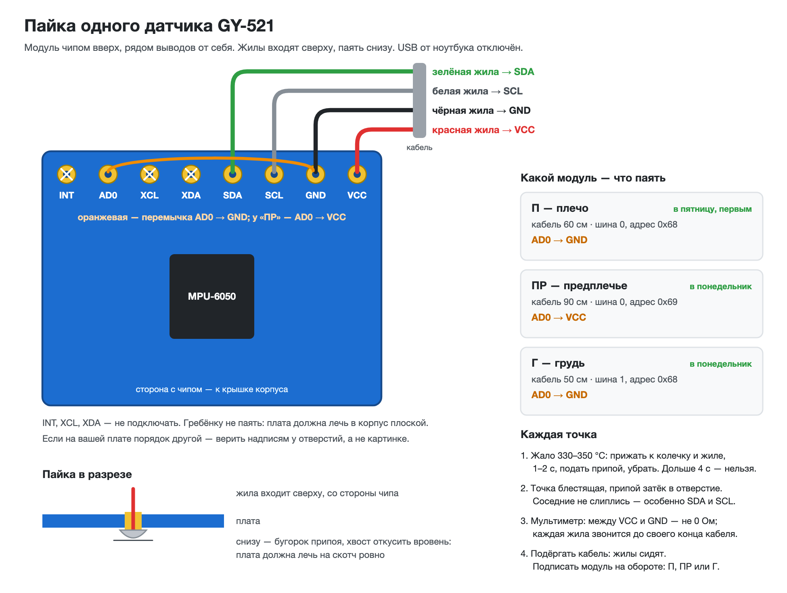

# Сборка датчиков: пайка, корпус, ремешок — по шагам

> **26 октября: без пайки.** На датчиках штырьки, кабели — полоски проводов мама-папа, раздача 3V3, GND,
> D21 и D22 — через макетную плату: [`../diagrams/схема-без-пайки.png`](../diagrams/схема-без-пайки.png). Разделы 1–3 ниже —
> для варианта с пайкой жил к модулю.

Текущий статус корпусов и готовых столов печати — [`../models/enclosure/print-ready/PRINT-STATUS.md`](../models/enclosure/print-ready/PRINT-STATUS.md). Это руководство описывает подключение и сборку трёх датчиков.

Порядок не менять: **сначала подключить и проверить поток данных, потом примерить корпус; клей — в самом конце.** Датчик, заклеенный до проверки, придётся выковыривать.

Схема подключения — [`../diagrams/схема-подключения.png`](../diagrams/схема-подключения.png). Подробности, на которые
ссылается этот файл: [`firmware/README.md`](../../firmware/README.md) (раздел 2 — подключение, 5 — калибровка, 7 — корпус,
8 — неисправности), приёмка — [`../../website/docs/ENGINEERING_10H/HARDWARE_ACCEPTANCE.md`](../../website/docs/ENGINEERING_10H/HARDWARE_ACCEPTANCE.md).

| Шаг | Что | Время |
|---|---|---|
| 0 | Собрать на столе всё нужное | 10 мин |
| 1 | Подготовить кабели | 20 мин |
| 2 | Спаять три модуля | 45–60 мин |
| 3 | Гнёзда на концах у платы | 20 мин |
| 4 | Проверка и ось X | 15 мин |
| 5 | Корпуса | 20–30 мин |
| 6 | Ремешки и надеть | 10 мин |
| 7 | Калибровка и проверка в приложении | 20 мин |
| | **Итого** | **2,5–3 часа** |

---

## Изменение схемы 22 октября: у каждого датчика свой кабель

Схема от 12 октября вела кабель предплечья через датчик плеча: вторые жилы впаивались в те же
4 отверстия. Так не делаем. Отверстие на GY-521 около 1 мм — две толстые жилы USB-кабеля в него
не влезут; в паз корпуса (5 мм) помещается один кабель; второй кабель через дальний паз пришлось бы
вести поверх платы, и крышка могла не закрыться.

Теперь **плечо, предплечье и грудь — каждый на своём кабеле**, все три кабеля идут к плате.
Кабели плеча и предплечья соединяются у платы: в гнёздах D21, D22 и GND — по две жилы, в гнезде
3V3 — три (плечо, предплечье, грудь). Для шины это одно и то же: оба датчика руки висят на тех же
D21 и D22, различаются выводом AD0. Шина руки выходит длиннее — около 1,5 м вместо 1 м. По расчёту
ёмкость такой шины меньше 400 пФ — предела I2C для 100 кГц; на плате это ещё не мерено. Если датчик
руки будет пропадать при движении — укоротить кабель предплечья или скрутить SDA с GND и SCL с GND.

---

## 0. Что нужно на столе

| Что | Сколько | Зачем |
|---|---|---|
| Паяльник, припой с флюсом, подставка | — | у Армана |
| Бокорезы, нож или стриппер, пинцет | — | резать и зачищать |
| Мультиметр | 1 | прозвонить жилы, проверить короткое замыкание |
| Плата ESP32 — уже прошита (12 октября, 460 800 бод), ноутбук, кабель USB-A → USB-C | 1 | проверять по ходу |
| GY-521 | 3 рабочих + запасной | плечо, предплечье, грудь |
| Готовые проекты печати | 3 | лежат в `../models/enclosure/print-ready/`; пробный корпус проверьте до отправки набора датчиков |
| Старые USB-кабели с передачей данных | 3 по 1 м | по кабелю на датчик |
| Провода мама-мама | 4 штуки | разрезать пополам — 7 гнёзд на выводы платы |
| Тонкий изолированный провод | 3 куска по 4 см | перемычки AD0; подойдёт тонкая жила от того же USB-кабеля |
| Термоусадка 2 мм и 6 мм | по 30 см | на каждую пайку провод к проводу |
| Двусторонний вспененный скотч, около 1 мм | 3 кусочка 15 × 12 мм | приклеить плату ко дну корпуса |
| Мелкие стяжки | 8 | держат кабель у корпуса и на ремешках |
| Изолента или малярный скотч, маркер | — | подписи, второй паз, крышка |
| Ремешки | 3 | для корпуса датчика — по размеру прорези; нагрудный корпус v3 поддерживает ремень 38 мм |
| По желанию: термоклей | — | капля в паз поверх кабеля |

Нет вспененного скотча — обычный двусторонний в два-три слоя. Нет термоусадки — изолента,
но на каждой пайке отдельно, чтобы жилы не касались друг друга.

---

## 1. Подготовить кабели

1. Отрезать с запасом 5 см: **плечо — 60 см**, **предплечье — 90 см**, **грудь — 50 см**.
2. С обоих концов снять внешнюю оболочку на 2 см. Фольгу, оплётку и голую жилу без изоляции
   (экран) — отрезать под корень и прикрыть изолентой: в работе они не участвуют, а торчащая
   проволочка может замкнуть.
3. С каждой из четырёх жил снять изоляцию на 4–5 мм, скрутить проволочки, облудить.
4. Цвета жил одинаковые на всех трёх кабелях и на обоих концах:

   | Жила | Куда |
   |---|---|
   | красная | VCC модуля → 3V3 платы |
   | чёрная | GND → GND |
   | зелёная | SDA → D21 (рука) или D32 (грудь) |
   | белая | SCL → D22 (рука) или D33 (грудь) |

   Цвета у кабеля другие — записать соответствие на листке и держать его одинаковым везде.
5. Мультиметр в режим прозвонки: каждая жила звонится с конца на конец; разные жилы между
   собой — не звонятся. Кабель с обрывом не брать.
6. Подписать кабели малярным скотчем у обоих концов: «П» — плечо, «ПР» — предплечье, «Г» — грудь.

---

## 2. Пайка модулей

**USB от ноутбука отключён всё время, пока паяльник в руках.**



Модуль держать чипом вверх, выводами от себя. Слева направо выводы такие:
INT, AD0, XCL, XDA, SDA, SCL, GND, VCC — как на фото ниже. Гребёнку к рабочим модулям **не паять**:
корпус рассчитан на плоскую плату.

| Модуль | Кабель | Перемычка AD0 | Адрес |
|---|---|---|---|
| плечо | «П», 60 см | AD0 → **GND** | шина 0, 0x68 |
| предплечье | «ПР», 90 см | AD0 → **VCC** | шина 0, 0x69 |
| грудь | «Г», 50 см | AD0 → **GND** | шина 1, 0x68 |

Для каждого модуля:

1. **Перемычка AD0.** Кусок тонкого провода 4 см, концы зачищены на 3 мм. Один конец вставить
   сверху в отверстие AD0. Второй конец пойдёт в GND (плечо, грудь) или в VCC (предплечье) —
   вместе с жилой кабеля, см. пункт 2. Перемычка лежит сверху вдоль ряда выводов.
2. **Жилы кабеля** вставить сверху, со стороны чипа: зелёная — SDA, белая — SCL, чёрная — GND,
   красная — VCC. В отверстие GND (или VCC у предплечья) — жила кабеля и конец перемычки вместе.
   Не влезают вдвоём — конец перемычки припаять сверху к колечку этого отверстия.
3. **Паять снизу.** Жало 330–350 °C: прижать к колечку и к жиле на 1–2 секунды, подать припой,
   убрать. Точка — блестящий бугорок, припой затёк в отверстие. Дольше 4 секунд не держать:
   колечко может отслоиться.
4. **Откусить хвосты** снизу вровень с припоем — плата должна лечь на скотч ровно.
5. **Проверить на просвет**: соседние точки не слиплись — особенно SDA и SCL, GND и VCC.
6. **Мультиметром**: между VCC и GND модуля — не ноль ом (ноль — значит, где-то замыкание);
   каждая жила звонится с отверстия модуля до своего конца кабеля.
7. Подёргать кабель — жилы сидят. Подписать модуль маркером на обороте: «П», «ПР» или «Г».

Перемычка AD0 обязательна: висящий AD0 — адрес «плавает», датчик то есть, то нет.

---

## 3. Гнёзда на концах у платы

Провода мама-мама разрезать пополам — получится 8 проводов с гнездом на одном конце.
Нужно 7. Каждое гнездо — на один вывод платы; на другом его конце спаиваются жилы кабелей.

| Гнездо → вывод платы | Какие жилы к нему спаять |
|---|---|
| **3V3** | красная «П» + красная «ПР» + красная «Г» |
| **GND** справа, рядом с 3V3 | чёрная «П» + чёрная «ПР» |
| **D21** | зелёная «П» + зелёная «ПР» |
| **D22** | белая «П» + белая «ПР» |
| **GND** слева, рядом с VIN | чёрная «Г» |
| **D32** | зелёная «Г» |
| **D33** | белая «Г» |

Для каждого гнезда: надеть термоусадку на провод гнезда, жилы скрутить вместе с его зачищенным
концом, пропаять, надвинуть термоусадку на пайку и прогреть (3V3 с тремя жилами — термоусадка 6 мм).
Подписать гнездо флажком из малярного скотча: «3V3», «D21» и так далее.

Выводы на плате ищутся по надписям рядом с ними. VIN не трогать: там 5 вольт.

---

## 4. Проверка и ось X

Гнёзда — на выводы платы по таблице выше, USB — к ноутбуку. Монитор порта Arduino IDE:
**460800 baud**, «New Line». Подробно про монитор — [`проверка-до-пайки.md`](проверка-до-пайки.md).

1. Нажать на плате **EN**. Должно быть: `датчиков найдено 3 из 3`, дальше паспорт и строки чисел.
2. `scan`:

   ```
   # шина 0 (SDA 21, SCL 22): 0x68 0x69
   # шина 1 (SDA 32, SCL 33): 0x68
   ```

3. `info`, все датчики лежат на столе чипом вверх: у каждого `длина` от 0,89 до 1,11 g, каждое
   число поворота не дальше 20 °/с от нуля. Текст ответа сохранить — это шаг 1 приёмки.
4. Подвигать каждый модуль — в `info` меняются числа только его строки: `upper_r` — плечо,
   `fore_r` — предплечье, `trunk` — грудь.

Не хватает датчика — по `scan` видно, какого: нет 0x68 на шине 0 — плечо, нет 0x69 — предплечье,
нет 0x68 на шине 1 — грудь. Проверить его четыре жилы, перемычку AD0 и гнёзда у платы
([`firmware/README.md`](../../firmware/README.md), раздел 8).

### Если `scan` не видит датчик — по шагам

Добавлено 26 октября. Порядок — от быстрого к долгому; паять только на шаге 7.

1. **Светодиод на GY-521 горит?** USB включён.
   - Не горит — до модуля не доходит питание. Мультиметр, постоянное напряжение: между выводами
     3V3 и GND платы ESP32 — 3,3 В; потом между пайками VCC и GND на модуле — тоже 3,3 В. Где пропало,
     там и обрыв: гнездо не на том выводе, жила оборвана, пайка не взялась.
   - Горит — питание есть, дело в SDA и SCL.
2. **Поменять местами гнёзда на D21 и D22**, `scan`. Нашёлся — зелёная и белая жилы перепутаны
   на одном из концов. Так и оставить, гнёзда подписать.
3. **Гнёзда точно на D21 и D22**, а не на TX0 и RX0 между ними — смотреть надписи у выводов платы.
4. **USB отключить, прозвонить.** От металла гнезда D21 до пайки SDA на модуле — звенит; D22 — SCL;
   3V3 — VCC; GND — GND. Соседние пайки на модуле между собой не звенят: SDA и SCL, VCC и GND, SDA и GND,
   SCL и GND. Между SDA и VCC несколько килоом — это резисторы на самом модуле, так и должно быть.
5. **USB включить, напряжение на пайках модуля:** SDA и GND — около 3,3 В, SCL и GND — тоже.
   Около нуля — линия замкнута на землю: искать каплю припоя между точками.
6. **Пошевелить кабель** у модуля и у гнёзд, глядя в монитор порта: прошивка ищет датчик каждые 2 с.
   То появляется, то пропадает — плохая пайка или надломленная жила.
7. **Перепаять плохую точку.** Флюс, прогреть 2–3 с, пока припой не растечётся и не станет блестящим,
   добавить немного свежего. Капля, которая не прилипла к жиле, значит жила не облужена: откусить 5 мм,
   зачистить, скрутить, облудить отдельно с флюсом и только потом паять. Перемычку между точками
   убрать оплёткой или стянуть жалом с флюсом. Жилы дешёвых USB-кабелей бывают из алюминия с медным
   покрытием: если припой не берёт совсем, взять другой кабель.
8. **Нашёлся на 0x69 или на шине 1** — тоже годится для «Проверки одним датчиком»: приложение
   само назовёт единственный датчик выбранным местом.

Не помогло — фото обеих сторон модуля с пайкой крупно и текст ответа `scan`.

### Ось X — один раз, до корпусов

У ваших модулей у светодиода PWR есть значок осей, но букв X и Y рядом нет. Поэтому ось находим
прошивкой: ось, которая смотрит вверх, показывает в `info` плюс 1 g.

1. Поставить модуль «П» на ребро так, чтобы **ряд выводов смотрел вверх**, чипом к себе, и держать
   неподвижно. `info`, строка `upper_r`, первое число после «ускорение» — это ось X:
   - **около +1.00** — +X смотрит в сторону выводов;
   - **около −1.00** — +X смотрит от выводов, к надписи MPU-6050;
   - **около 0, а второе число около ±1** — X идёт **вдоль** ряда выводов, см. ниже.
2. На обороте платы нарисовать маркером стрелку +X. Проверить так же «ПР» и «Г» — модули одной
   партии почти наверняка одинаковые, но это минута.

**Ось X и корпус.** Сверьте +X платы с ориентацией корпуса v3: модель и порядок сборки описаны в [`../models/enclosure/ПЕЧАТЬ-v3.md`](../models/enclosure/ПЕЧАТЬ-v3.md). Если ось платы отличается, корпус не печатайте до согласования поворота платы в приложении.
---

## 5. Корпус

Используйте актуальный корпус v3 для датчиков со штырьками: [`../models/enclosure/ПЕЧАТЬ-v3.md`](../models/enclosure/ПЕЧАТЬ-v3.md).
Там есть примерка, ориентация платы, установка крышки, крепление кабеля и список файлов для печати.
Сначала проверьте пробный корпус; серийный комплект запускайте после положительной проверки защёлки и посадки платы.

## 6. Ремешки и как надеть

Для плеча и предплечья используйте ремешок, который проходит через прорези корпуса датчика v3. Для груди предусмотрен отдельный корпус под ленту 38 мм. Схема маршрута ремешка и ограничения ширины — [`../models/enclosure/ПЕЧАТЬ-v3.md`](../models/enclosure/ПЕЧАТЬ-v3.md).

- Крышка смотрит наружу, от кожи; длинная сторона корпуса идёт вдоль кости.
- Затяните ремешок так, чтобы корпус не ездил, но пальцы не немели.
- Отметьте положение датчика на коже или рукаве, чтобы повторный тест начинался с того же места.

## 7. Калибровка и проверка в приложении

1. **Калибровка** — команда `cal` в мониторе порта, около 2 минут, все три датчика сразу,
   в корпусах — у коробки шесть ровных граней ([`firmware/README.md`](../../firmware/README.md), раздел 5). Потом `cal`
   ещё раз — проверить, что числа повторились. Строки `# cal_…` обеих калибровок сохранить.
2. **Закрыть монитор порта** — иначе приложение не получит порт.
3. **Приложение**: в папке `website` — `npm run dev`, Chrome — адрес из Терминала, `#/devices`
   в конце. «USB (Web Serial)» → «Подключить» → порт `cu.usbserial…`. Должно быть: поток активен,
   **3 датчика из 3**, у каждого зелёная точка.
4. **Запись 60 секунд** без разрывов — 6 000 строк ± 1 (приёмка, шаг 3). Сырой CSV сохранить.
5. **Живой угол в локте**: пространство клиники → «Новый тест» → источник USB → калибровка
   3 секунды руки вдоль тела → сгибать локоть, угол меняется на экране.

---

## Что сохранить

Папка `stand-data/2026-10-22/` (завести, если нет):

- `modules.txt` — ответы `info` и `scan`, куда смотрит +X у каждого модуля;
- `calibration.txt` — строки `# cal_…` двух калибровок;
- фото пайки каждого модуля сверху и снизу, фото гнёзд у платы, фото собранных датчиков на руке;
- CSV записи 60 секунд.

Неудачная проверка — тоже сохраняется: это находка, а не мусор.

---

## Чего не делать

- Не паять при включённом USB.
- Не клеить корпус до проверки `scan` и `info`.
- Не паять гребёнку к рабочим модулям.
- Не класть плату в корпус чипом вниз.
- Не тянуть датчик за кабель — только за корпус.
- Не подключать ничего к VIN.

## Если что-то не так

| Что видно | Почему | Что делать |
|---|---|---|
| `датчиков найдено 0 из 3` | гнёзда не на тех выводах, нет 3V3 или GND | сверить гнёзда с таблицей шага 3; мультиметр: 3,2–3,4 В между VCC и GND каждого модуля |
| Одного датчика нет в `scan` | жила, пайка или перемычка AD0 этого модуля | прозвонить его 4 жилы; AD0: плечо и грудь — GND, предплечье — VCC |
| `scan` видит 0x68 вместо 0x69 на шине 0, и датчиков 2 из 3 | у предплечья AD0 не на VCC | перепаять перемычку предплечья |
| `длина` далеко от 1 g | модуль или пайка | перепаять; не помогло — заменить запасным |
| Датчик пропадает, когда двигаешь кабель | пайка держится плохо или кабель без стяжки | пропаять заново, стяжка у паза |
| Крышка не закрывается | кабель толще 4,6 мм или жилы горкой | уложить жилы плоско; кабель тоньше |
| В приложении «Устройство не прислало паспорт» | открыт монитор порта | закрыть монитор, подключить заново |

Остальное — [`firmware/README.md`](../../firmware/README.md), раздел 8.
