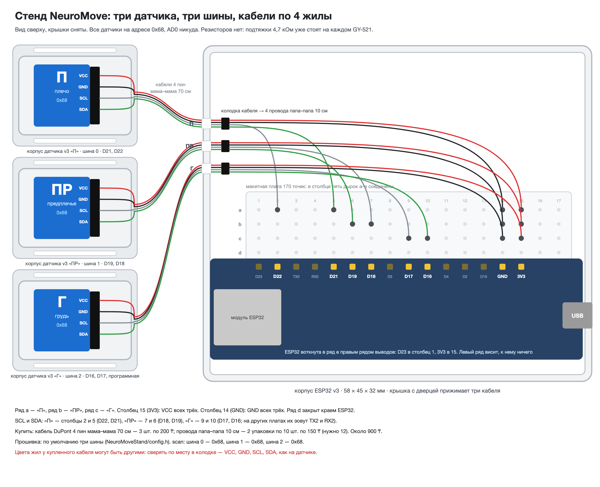
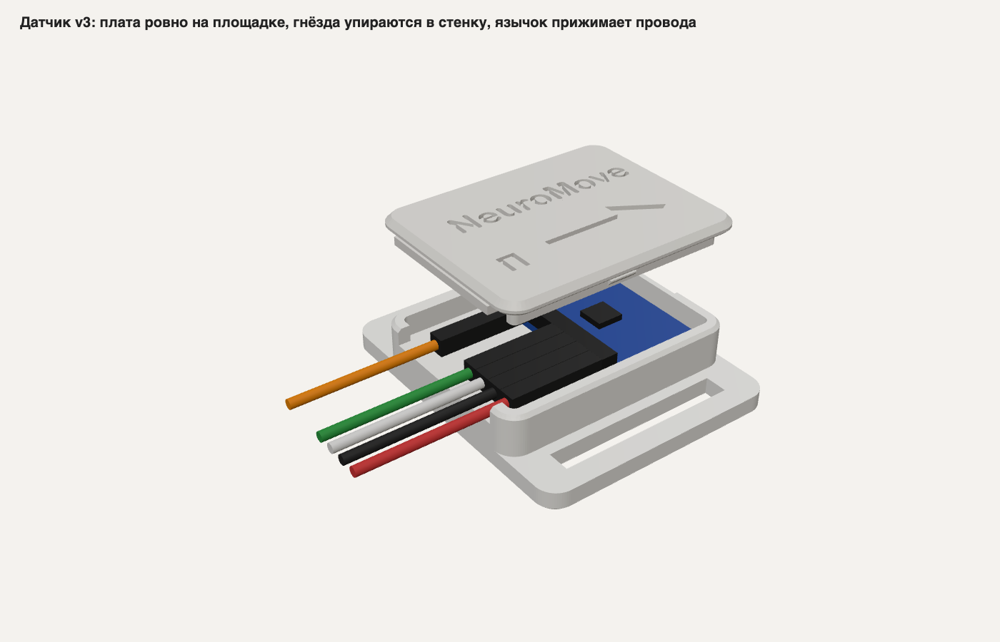
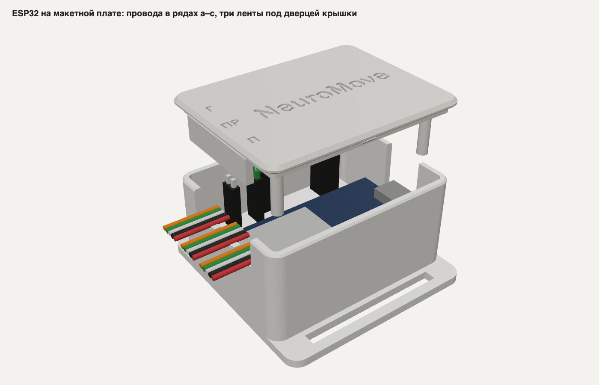
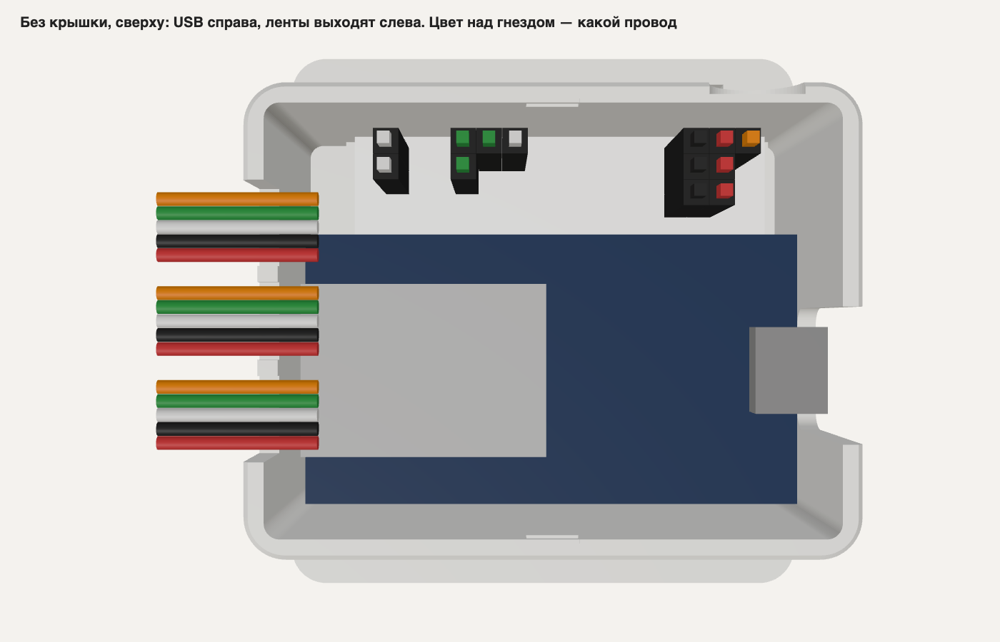

# Стенд NeuroMove v3: печать, сборка, провода, прошивка

Обновлено 27 октября 2026. Здесь всё, что нужно, чтобы собрать стенд из трёх датчиков без пайки:
что купить, как напечатать корпуса, как собрать датчики и корпус ESP32, как подключить провода,
как прошить плату и проверить, что всё работает.

Физический статус контрольной пробы и готовых столов — [`print-ready/PRINT-STATUS.md`](print-ready/PRINT-STATUS.md). Геометрические проверки модели описаны в [`ПРОВЕРКА-v3.md`](ПРОВЕРКА-v3.md). Прошивка залита в плату утром 27 октября. Один датчик на ней
проверен на шине 0 и на программной шине 2. Три датчика сразу ещё не включали.

Эта версия рассчитана на датчик со штырьками и плату ESP32 на макетной плате. Используйте STL и готовые проекты из `print-ready/`.



## Как устроен стенд

У каждого датчика своя шина I2C, и все три отвечают на адрес 0x68. Вывод AD0 никуда не подключается.
Поэтому к каждому датчику идёт кабель всего на 4 жилы: VCC, GND, SCL, SDA.

| Датчик | Шина | Выводы ESP32 |
|---|---|---|
| «П», плечо | шина 0, аппаратная | SDA на D21, SCL на D22 |
| «ПР», предплечье | шина 1, аппаратная | SDA на D19, SCL на D18 |
| «Г», грудь | шина 2, программная | SDA на D16, SCL на D17 |

Аппаратных шин у ESP32 только две. Третью прошивка ведёт сама, она описана в
[`../NeuroMoveStand/soft_i2c.h`](../NeuroMoveStand/soft_i2c.h). На плате HW-394 выводы третьей шины
подписаны D16 и D17. На других платах ESP32 их могут подписать RX2 и TX2.

Резисторы не нужны: подтяжки на SDA и SCL уже стоят на каждой плате GY-521.

## Что купить

Всё есть в AmperMarket (Астана, пр. Абая, 95). Цены и наличие проверены на сайте 27 октября.

| Что | Сколько | Цена |
|---|---|---|
| [Кабель DuPont 4 пин «мама–мама» 70 см](https://ampermarket.kz/plugs/dupont-connectors/dupont-female-female-4pin/) | 3 шт. | 200 ₸ за штуку |
| [Провода «папа–папа» 10 см, 10 шт.](https://ampermarket.kz/wires/papa-papa-10cm/) | 2 упаковки | 150 ₸ за упаковку |
| Макетная плата на 170 точек, 45 × 33 мм | 1 | уже есть |

Всего около 900 ₸.

У кабеля на каждом конце одна чёрная колодка на 4 гнезда. Это видно по фото товара. Одна колодка
надевается на датчик, вторая лежит внутри корпуса ESP32. В неё вставляются четыре провода «папа–папа»,
их вторые концы идут в дырки макетной платы. Провода «мама–папа» здесь не подойдут: в колодку и в дырку
макетной платы входит только «папа».

## Печать

Сначала печатается проба: один корпус датчика и крышка «П», около 8 г. В корпус кладётся датчик
с надетым кабелем, крышка закрывается. Села и держит, значит можно печатать остальное.

### До печати: три замера линейкой

Три размера никто не мерил, они взяты по расчёту. Если хоть один не совпадает, модель пересобирается
за минуту.

| Что мерить | Должно быть | Если не так |
|---|---|---|
| Ширина плоского кабеля 4 пин | 5–6 мм, одна жила 1,3–1,5 мм | Пересобрать с толщиной жилы: `python3 korpus_v3.py --provod 1.2` |
| Хвосты выводов под платой датчика вместе с пайкой | не длиннее 3,4 мм | Откусить кусачками до 3 мм |
| Сколько провод «папа», воткнутый в макетную плату, торчит над ней | не больше 15 мм | Написать Амирхану |

### На Bambu Lab A1

Детали уже разложены по столу. Печатать по порядку:

| Файл | Что на столе | Примерно |
|---|---|---|
| `print-ready/A1-1-proba-ready.3mf` | проба корпуса датчика и крышка «П» | 26 мин |
| `print-ready/A1-2-datchiki-G38-ready.3mf` | корпуса датчиков, нагрудный корпус под ремень 38 мм и крышки | 44 мин |
| `print-ready/A1-3-esp32-ready.3mf` | корпус ESP32 и его крышка | 60 мин |

Время оценено по объёму деталей. Точное покажет Bambu Studio после нарезки. К каждому запуску
прибавить 3–5 минут: перед печатью A1 сам калибруется.

1. Откройте нужный проект из `print-ready/` в Bambu Studio. Не используйте `A1-2-datchiki-template.3mf` — это только входной шаблон генератора.
2. Используйте Bambu Lab A1, сопло 0,4 мм и Generic PLA. В готовых проектах сохранён профиль 0.20mm Standard @BBL A1, 3 стенки, заполнение 20%, поддержки выключены.
3. Не поворачивайте детали и не меняйте раскладку. Перед отправкой сверьтесь с [`PRINT-STATUS.md`](print-ready/PRINT-STATUS.md).
4. Сначала проверьте пробный корпус. Комплект из трёх датчиков отправляйте только после проверки посадки платы и удержания крышки.

Столы собирает [`pechat_a1.py`](pechat_a1.py) из STL рядом с этим файлом. Он же проверяет,
что каждая деталь стоит на столе, не выходит за его край и не задевает соседнюю.

### На другом принтере

Файлы STL рядом с этим документом:

| Файл | Сколько | Пластика при сплошном заполнении |
|---|---|---|
| `korpus-v3-datchik-korpus.stl` | 3 | 6,5 см³ |
| `korpus-v3-datchik-kryshka-P.stl` | 1 | 1,7 см³ |
| `korpus-v3-datchik-kryshka-PR.stl` | 1 | 1,7 см³ |
| `korpus-v3-datchik-kryshka-G.stl` | 1 | 1,7 см³ |
| `korpus-v3-esp32-korpus.stl` | 1 | 17,5 см³ |
| `korpus-v3-esp32-kryshka.stl` | 1 | 5,7 см³ |

Всего около 50 см³, при заполнении 20% это примерно 35 г PLA. Настройки: PLA или PETG, слой 0,2 мм,
3 периметра, заполнение 20%, без поддержек. Корпус кладётся дном на стол, крышка надписью на стол.

### Проба защёлки

Крышка держится на защёлке, без клея. Ставится она только одной стороной: язычок крышки входит в паз
на торце, через который выходит кабель.

1. Нажать на крышку большим пальцем. Она должна щёлкнуть и лечь ровно, без щели по краю.
2. Перевернуть корпус и потрясти. Крышка не должна отпасть.
3. Чтобы открыть, поддеть ногтем или монеткой в выемке на глухом торце. Крышка должна сниматься без треска.

| Что вышло | Что сделать |
|---|---|
| Крышка не лезет или щёлкает с большим трудом | Перепечатать крышку с XY-компенсацией −0,1 мм |
| Щёлкает, но держит слабо или отпадает | Перепечатать крышку с XY-компенсацией +0,05 мм |
| Щёлкнула, держит, открывается монеткой | Печатать остальное с теми же настройками |

Компенсацию ставят только крышкам, корпусу никогда. В Bambu Studio это правая кнопка по крышке,
Add settings, Quality, X-Y contour compensation. В Cura это Horizontal Expansion, в PrusaSlicer
XY Size Compensation.

## Сборка датчика



Корпус 35,8 × 27,8 × 10,5 мм, с основанием под ремешок 43,8 мм. Прорезь под ремешок 26 мм,
ремешок нужен не шире 25 мм.

Дно внутри ступенькой. У глухого торца площадка, на ней лежит плата. Дальше канавка, в неё уходят
хвосты выводов, поэтому плата лежит ровно, без наклона в 11°. У торца с пазом полка, на ней лежит
колодка кабеля.

1. На площадку наклеить кусочек тонкого двустороннего скотча, не вспененного. От вспененного плата
   встанет выше, и язычок крышки передавит провода.
2. Надеть колодку кабеля на первые четыре штырька датчика: VCC, GND, SCL, SDA. Штырьки XDA, XCL, AD0,
   INT остаются пустыми.
3. Положить плату чипом вверх, штырьками к пазу. Хвосты выводов уходят в канавку, дальний край платы
   прижат к глухому торцу. Прижать плату к скотчу.
4. Кабель лежит в пазу плоско, жилы не перекручены. Колодка лежит на полке.
5. Поставить крышку язычком к пазу и нажать до щелчка. Язычок прижмёт кабель сверху.

Если дёрнуть за кабель, колодка упрётся в стенку у паза. Тянется корпус, а не штырьки. Колодка может
отъехать от штырьков не дальше чем на 1,5 мм, на штырьке остаётся 4,5 мм из 6.

Если кабель в пазу болтается, обмотать его изолентой в два-три слоя там, где он лежит в пазу.

Стрелка на крышках «П» и «ПР» смотрит от кабеля, к кисти. На крышке «Г» она смотрит к кабелю, вниз.
Стрелка показывает ось X платы: она идёт поперёк ряда выводов, от выводов.

## Корпус ESP32 и макетная плата



Корпус 58,4 × 45,1 × 31,8 мм, с основанием под ремень 61,1 мм. Ремень или липучка нужны не шире 40 мм.
Корпус носится на поясе вертикально: USB снизу, кабели сверху.

### Как воткнуть ESP32 в макетную плату

На макетной плате 17 столбцов. В каждом столбце два ряда по 5 дырок, a–e и f–j. Пять дырок одного
столбца в рядах a–e соединены между собой.

1. В ряд e втыкается правый ряд выводов ESP32, тот, где 3V3, GND, D15 и дальше до D23. Вывод D23 идёт
   в столбец 1, тогда 3V3 окажется в столбце 15.
2. Левый ряд (VIN, GND, D13 и дальше до EN) висит за краем макетной платы. К нему ничего не подключается.
3. У каждого вывода остаются свободными три дырки: a, b, c. Ряд d закрыт краем платы ESP32, провод туда
   не встанет.

Важно, чтобы в макетной плате был именно правый ряд. В нём все нужные выводы, и через его дырки 3V3
и GND раздаются на три датчика. На висящий ряд провод не надеть: гнездо уходит на 14 мм вниз, а до дна
корпуса там 9 мм.



### Провода на макетной плате

Датчик «П» подключается в ряд a, «ПР» в ряд b, «Г» в ряд c. Каждый провод «папа–папа» одним концом
вставлен в колодку кабеля, другим в дырку.

| Столбец | Вывод ESP32 | Ряд a | Ряд b | Ряд c |
|---|---|---|---|---|
| 2 | D22, SCL шины 0 | SCL «П» | | |
| 5 | D21, SDA шины 0 | SDA «П» | | |
| 6 | D19, SDA шины 1 | | SDA «ПР» | |
| 7 | D18, SCL шины 1 | | SCL «ПР» | |
| 9 | D17, SCL шины 2 | | | SCL «Г» |
| 10 | D16, SDA шины 2 | | | SDA «Г» |
| 14 | GND | GND «П» | GND «ПР» | GND «Г» |
| 15 | 3V3 | VCC «П» | VCC «ПР» | VCC «Г» |

Цвета жил у купленного кабеля могут отличаться от наших. Сверять нужно по месту в колодке:
VCC, GND, SCL, SDA идут в том же порядке, что на датчике. На каждый кабель с обеих сторон
наклеить флажок из скотча с буквой датчика.

### Сборка корпуса ESP32

1. В корпусе у стенок четыре упора под макетную плату и две квадратные опоры у другой стенки.
   На каждую опору наклеить два слоя вспененного двустороннего скотча.
2. Снять плёнку с клейкого низа макетной платы. Опустить макетную плату с воткнутой ESP32 между
   упорами: ряд a к стенке, USB-C в вырез торца. Висящий край ESP32 ляжет на опоры со скотчем. Прижать.
3. Вставить провода по таблице. Над гнёздами остаётся 5 мм на изгиб, провода сразу уложить вдоль
   стенки к торцу с окном.
4. Колодки кабелей лежат внутри у торца с окном. В торце три ложбинки, над ними на крышке выдавлены
   буквы П, ПР, Г. Каждый кабель кладётся плоско в свою ложбинку.
5. Поставить крышку дверцей к ложбинкам и нажать до щелчка. Дверца прижмёт кабели, штыри крышки
   прижмут висящий край ESP32. Открывается крышка ногтем за выемку на длинной стенке у USB.

Ложбинки рассчитаны на плоскую ленту шириной до 7,8 мм. Если кабель в ложбинке болтается, его
обматывают изолентой, как у датчика.

## Прошивка

Прошивка лежит в [`../NeuroMoveStand/`](../NeuroMoveStand/). Три шины включены по умолчанию,
менять ничего не нужно.

Залить через PlatformIO, из папки `firmware`:

```bash
pio run -t upload
```

Через Arduino IDE: открыть `NeuroMoveStand/NeuroMoveStand.ino`, плата ESP32 Dev Module, Upload.
Если загрузка не начинается, зажать на плате кнопку BOOT, пока не пойдут проценты.

### Проверка

Открыть монитор порта на 460 800 бод с «новой строкой» и отправить `scan`. Когда подключены все три
датчика, должно быть так:

```
# шина 0 (SDA 21, SCL 22): 0x68
# шина 1 (SDA 19, SCL 18): 0x68
# шина 2 (SDA 16, SCL 17, программная): 0x68
```

Потом отправить `info`. У каждого датчика, который лежит неподвижно, длина ускорения должна быть
около 1 g, а поворот около нуля. Потом пошевелить каждый кабель, глядя в монитор. Строк
«перезапускаю шину» быть не должно.

После перехода на три шины старые поправки калибровки к датчикам не подходят. Прошивка это видит
и пишет, что поправки чужие. Нужно один раз выполнить `cal`: шесть положений, около двух минут.

Прежняя разводка, где две шины и у «ПР» пятый провод с AD0 на 3V3, осталась в прошивке. Для неё нужно
раскомментировать `#define NM_TWO_BUSES` в [`../NeuroMoveStand/config.h`](../NeuroMoveStand/config.h).
С корпусом v3 она не нужна.

## Один датчик, без макетной платы

Для теста с одним датчиком макетная плата и корпус ESP32 не нужны. Прошивка та же.


1. Одна колодка кабеля надевается на датчик: VCC, GND, SCL, SDA.
2. Во вторую колодку вставляются четыре коротких провода «мама–папа»: «папа» в колодку, «мама»
   на вывод ESP32. VCC идёт на 3V3, GND на GND, SCL на D22, SDA на D21.
3. Стык колодки и проводов обмотать изолентой, чтобы не разошёлся.
4. `scan` должен показать на шине 0 адрес 0x68.

## Если не работает

| Что видно | Что проверить |
|---|---|
| `scan`: на шине никого | USB был отключён, пока подключали? VCC на 3V3, GND на GND? Не перепутаны SCL и SDA? Не надета ли колодка задом наперёд? |
| «перезапускаю шину» при шевелении кабеля | Плохой контакт в колодке или в дырке макетной платы. Поджать, обмотать стык изолентой |
| «перезапускаю шину» часто и без шевеления | Снизить частоту шины: в `config.h` поставить `I2C_HZ = 50000` и перепрошить |
| «отвечает WHO_AM_I 0x70, а не 0x68» | Это копия чипа MPU-6050, так и бывает. Регистры у копии те же, данные нормальные |
| «поправки сняты с другого модуля» | Выполнить `cal` |
| Плата не прошивается | Отключить датчики, зажать BOOT при загрузке |
| Крышка не закрывается или не держит | Раздел «Проба защёлки» |

## Что проверено, а что нет

Проверено моделью: все размеры корпусов, защёлка и тысяча случайных отпечатков с ошибками принтера
([`ПРОВЕРКА-v3.md`](ПРОВЕРКА-v3.md)). Прошивка проверена на компьютере на модели датчика (135 проверок)
и собрана под ESP32 без ошибок.

Проверено на железе 27 октября: один датчик «П» читается на шине 0 и на программной шине 2, пропусков нет.

Не проверено: печать корпусов, шина 1 на D19 и D18, три датчика сразу, толщина жил купленного кабеля.
Наклон 11° и длина хвостов выводов взяты из замера Амирхана, а не измерены отдельно.
