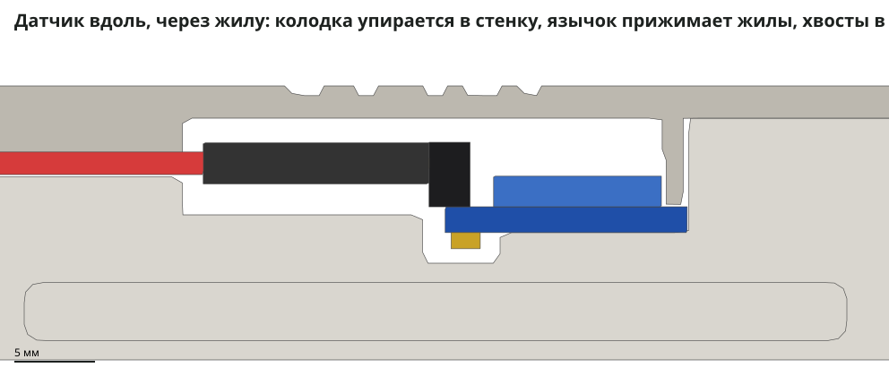
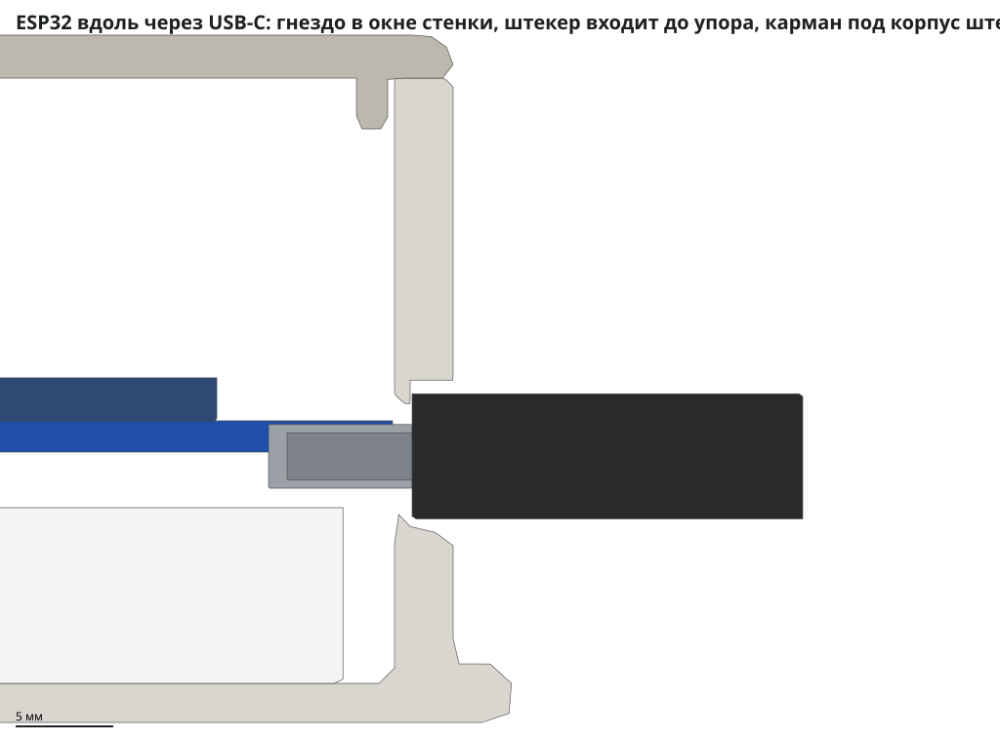
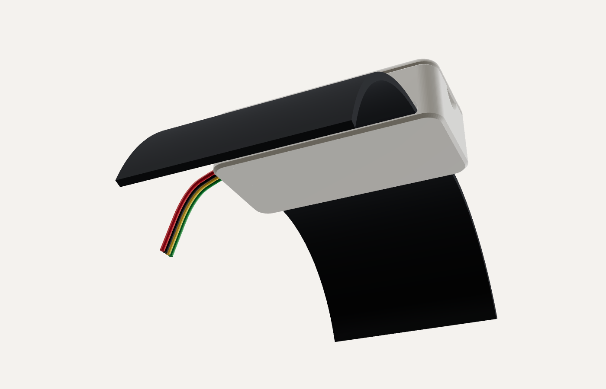

# Корпуса v4 — печать и сборка (8 ноября 2026)

Что исправлено против v3:

- **крышки держат**: защёлка повторяет ту, что поставил сокомандник на корпус ESP32;
- **датчик с проводами помещается**: внутри просторнее, хвосты штырьков больше не должны попадать в узкую канавку;
- **окно USB-C — по разъёму**: овал 9,6 × 4,0 мм вместо выреза 13 мм шириной до самого верха.

Внешний вид подогнан под лендинг: белая «галька» со знаком «nm», точка знака и короткая черта — киноварь `#b7452c`.

Исходник — [`korpus_v4.py`](korpus_v4.py). Он строит модели, прогоняет проверки и выгружает STL. Остальные скрипты:

- [`pechat_v4.py`](pechat_v4.py) — столы печати;
- [`vid_v4.py`](vid_v4.py) — 3D-просмотр;
- [`razrez_v4.py`](razrez_v4.py) — сечения.

Ни один корпус v4 ещё не печатался. Всё проверено на модели: все 78 проверок корпусов и 12 проверок подробных моделей проходят, Bambu Studio нарезает все три стола без ошибок.

## Что поменял сокомандник и почему его крышка держит

Его файлы `korpus-v3-esp32-korpus.step` и `korpus-v3-esp32-kryshka.step` (Fusion, 3 ноября) сравнивались с нашей v3: тела вычитались одно из другого, места различий измерялись. Крышка у него та же, что у нас, только перевёрнута для печати. Отличия:

| Где | v3 | Сокомандник | Что это даёт |
|---|---|---|---|
| Паз защёлки в стенке корпуса | 0,5 мм вглубь | **1,0 мм** | выступ целиком проваливается в паз, даже если пластик лёг толще; щелчок чёткий |
| Выступ на балке крышки, сторона +Y | 0,55 мм за бортик, натяг 0,3 | **0,75 мм, натяг 0,5** | крышку держит, а не «прилегает» |
| Зазор бортика у стенки −Y и у торцов | 0,25 мм | **0,35 мм** | бортик не трётся о стенки, крышка садится до конца |
| Основание | ушки с прорезями 42 мм | **сплошная плита 66,4 × 61,1 × 3 мм**, прорези 50,5 мм | жёсткое ровное дно, ремень до 50 мм |
| Дверца проводов | вровень со стенкой | утоплена на 0,2 мм | не выпирает |

Причина слабой защёлки v3 — маленькие числа. Выступ 0,55 мм на принтере выходит одной-двумя линиями пластика. Паз 0,5 мм забивается наплывом стенки. В итоге выступ цеплялся за стенку на 0,1–0,2 мм, а не на 0,3.

Точный профиль его выступа (срез файла посередине): на стороне +Y выступ выходит за грань стенки на 0,5 мм, высотой 1,22 мм, скосы 45° и 45°; на стороне −Y — на 0,3 мм, скосы 42° и 52°; длина выступа 4 мм, паз 1,0 мм вглубь и 1,72 мм высотой.

В v4 защёлка держит сильнее, чем у сокомандника:

| | Сокомандник | v4, ESP32 | v4, датчик |
|---|---|---|---|
| Выступ заходит за стенку | 0,5 и 0,3 мм | 0,6 мм с обеих сторон | 0,5 мм с обеих сторон |
| Длина выступа | 4 мм | 10 мм | 8 мм |
| Удерживающий скос (от вертикали) | 45° и 52° | 60° | 60° |
| Сколько защёлок | 2 | 3 — третья на торце у USB-C | 2 |
| Паз в стенке | 1,0 мм | 1,0 мм | 1,0 мм |
| Зацеп (длина × заход, сумма) | 3,2 мм² | 17,5 мм² | 8 мм² |

Балки при защёлкивании растягиваются на 1,47 % (длинные стороны ESP32), 1,12 % (торец ESP32) и 1,35 % (датчик) — PLA выдерживает около 2 %. Зазор бортика у длинных стенок 0,3 мм, у торцов 0,35. Открывать — ногтем в выемку.

## Датчик — 61 × 29,5 × 17,0 мм, ремешок 5 см



**Размеры датчика — замер Амирхана 8 ноября:**

- плата 20 × 15 мм, ряд штырьков вдоль стороны 20 мм;
- со штырьками поперёк ряда — 22 мм: штырьки выходят за край платы на 7 мм;
- по высоте 7 мм: хвосты штырьков снизу 1 мм, плата, штырьки с колодкой сверху — 4 мм над платой.

На столе датчик лежит на хвостах, и сторона со штырьками поднимается на 3,8° (1 мм на 15 мм). В корпусе наклона нет: плата лежит ровно на площадке, хвосты свисают в колодец.

- **Почему не помещалось.** В v3 плата лежала на площадке, а хвосты выводов должны были точно попасть в канавку шириной 4,6 мм. Если хвосты стояли чуть иначе, плата ложилась на них и поднималась примерно на 3 мм. Над гнёздами при этом было всего 0,3 мм.
- **Что теперь под платой.** Под краем со штырьками — открытый колодец на всю ширину, глубиной 1,9 мм. Хвосты длиной до 1,5 мм с пайкой не касаются дна, где бы они ни стояли. Над штырьками и колодкой кабеля — 1,5 мм воздуха.
- **Под какую сборку.** На штырьки VCC, GND, SCL и SDA надета одна колодка DuPont 4 пин. Колодка лежит на полке. Если дёрнуть кабель, колодка упрётся в стенку: в паз для жил она не пролезает. На штырьках при этом остаётся не меньше 4,4 мм. Колодка — на той стороне платы, где VCC, GND, SCL, SDA (по фото 8 ноября): паз для жил тоже с этой стороны, в первом варианте v4 он был зеркально.
- **Как держится плата.** Дальний край платы прижат к стенке +X. Сверху на него давит планка крышки, поэтому клей и скотч не нужны.
- **Провода.** Четыре жилы выходят в паз торца −X, язычок крышки прижимает каждую на 0,3 мм. Жилы до 1,7 мм тоже входят.
- **Ремешок.** У всех датчиков ремешок 5 см. Он проходит под датчиком сквозь скрытый туннель 51 × 3,6 мм, как на референсе, сверху его не видно. Ремешок до 50 мм шириной и до 3 мм толщиной. Из-за туннеля под 5 см датчик длиной 61 мм: ремешок идёт поперёк, и его ширина ложится вдоль корпуса.
- **Потолок туннеля печатается мостом 51 мм** и может провиснуть на 0,2–0,4 мм. Туннель сделан высотой 3,6 мм, чтобы ремешку 3 мм всё равно хватило места. Проверить на пробе: ремешок должен пройти.
- **Крышка.** На ней знак «nm» и буква датчика. Черта киноварью стоит со стороны +X у «П» и «ПР», со стороны кабеля у «Г». Крышка встаёт только одной стороной. Открывать — ногтем в выемку на торце +X.
- **Три датчика одинаковые.** «П», «ПР» и «Г» отличаются только крышкой. Отдельного нагрудного корпуса под 38 мм больше нет.

Проверено на разбросе деталей:

- плата 14,6–15,4 × 19,6–20,4 мм;
- пластик штырьков выступает за край платы на 0,5–1,5 мм;
- хвосты до 1,5 мм;
- ось штырька на 2,4–3,0 мм над платой (верх колодки — около 4 мм над платой, как в замере).

## ESP32 на макетной плате — 70,4 × 47,1 × 35,2 мм, плита 76,4 × 61,1 мм



- **Какой ряд в макетной плате.** С 8 ноября в макетную плату воткнут ряд 3V3, GND, D23 … D15 (у стенки +Y), висит ряд VIN, GND, D13 … EN — он лежит на опорах у стенки −Y.
- **Корпус длиннее на 10 мм.** Полка у торца −X кончается до торца ESP32 — ESP32 с макетной платой опускается прямо сверху, без наклона. А провода «папа–папа» ложатся одним ровным жгутом, без петель.
- **Полка у торца −X — одно целое со стенками.** Доска 2,2 мм на всю ширину и 9,5 мм в длину, на высоте колодок кабелей «мама»: они лежат на полке и приматываются изолентой. Печатается мостом 41 мм между стенками ±Y, без поддержек; Bambu Studio режет её без предупреждений (полка с окнами у стенки давала «floating cantilever»).
- **Пины — под перепрошивку.** Все провода «папа» — в ряды a–c макетной платы, к выводам воткнутого ряда:

| Датчик | VCC | GND | SDA | SCL |
|---|---|---|---|---|
| П — плечо | 3V3 | GND | D23 | D22 |
| ПР — предплечье | 3V3 | GND | D21 | D19 |
| Г — грудь | 3V3 | GND | D18 | D17 |

  Модуль на плате — ESP-32D (N4: 4 МБ флеш, без PSRAM): D16 и D17 у него свободны, в отличие от модулей с PSRAM. Все пины — с воткнутого ряда. Не взяты TX0 и RX0 (через них идёт USB-порт), D2, D5, D15 (от них зависит загрузка). Самые дальние от колодок пины — у «П»: у его колодки меньше всего места на дугу жгута. В прошивке (`firmware/NeuroMoveStand/config.h`) поменять пины трёх шин на эти.
- **Провода «папа–папа» — ровным жгутом, без изоленты.** Из колодок на полке — дугой к висящему краю ESP32, вдоль него к концу с USB-C, по торцу к стенке −Y и обратно над рядами a–c к своим пинам. Все шесть сигнальных проводов ложатся так ровно на 10 см. Шесть проводов питания короче любого ровного пути: 3V3 и GND стоят у самого USB-C. Им нужно: VCC П — 7,5 см, GND П — 8,0, VCC ПР — 8,2, GND ПР — 8,7, VCC Г — 9,0, GND Г — 9,9 см. С проводами по 10 см у них останется 0,1–2,5 см слабины — её уложить мягкой дугой у края.
- **USB-C — по замерам 8 ноября.** По ширине гнездо ближе к краю с D23/3V3 (он над макетной платой): от этого края ESP32 до края гнезда 8,0–8,5 мм (взято 8,25), от края макетной платы — около 2 см, как и в замере. По высоте низ гнезда — 9,5–10,5 мм над низом макетной платы (взято 10,0): гнездо утоплено в плату. Окно с запасом — 10,0 × 4,8 мм (гнездо 8,94 × 3,26), снаружи карман 13,4 × 7,8 мм под корпус штекера.
- **Почему окно совпадает с разъёмом.** Торец ESP32 упирается в стенку +X, гнездо входит в окно. По Y плату ставят бортики опор под висящим краем. Палец крышки у антенны поджимает плату к стенке на 0,3 мм; он гибкий, плата 51–52,3 мм тоже входит.
- **Как вставлять.** ESP32 с макетной платой опустить сверху примерно на 1,3 мм ближе к −X и сдвинуть к стенке USB — гнездо войдёт в окно. Провода «папа» — в макетную плату, колодки — на полку и примотать изолентой, жгут уложить дугой вдоль висящего края, ленты кабелей — в ложбинки, закрыть крышку.
- **Кнопки.** Кнопки EN и BOOT ничто не нажимает.
- **Стенки.** Стенки 3 мм, на скруглённых углах снаружи — 1,55 мм.
- **Бортик на дне за макетной платой.** Корпус длиннее ESP32, и чтобы она не ездила, за торцом макетной платы на дне стоит бортик 3 мм. Вплотную его поставить нельзя: ESP32 опускают на 1,3 мм ближе к −X и потом сдвигают в окно USB-C. Поэтому зазор 1,6 мм: с открытой крышкой плата дальше не уедет, с закрытой её держат палец крышки и гнездо в окне.
- **Основание.** Плита с прорезями ремня 50,5 мм — как у сокомандника, длиннее на 10 мм вместе с корпусом.

## Как надеть



Положение — по [`прототип.md`](../../../прототип.md), раздел «Крепление». Общие правила:

- крышка наружу, от кожи;
- длинная сторона корпуса — вдоль кости;
- ремешок 5 см продевается в туннель под датчиком и застёгивается вокруг руки или груди;
- затянуть так, чтобы корпус не ездил, но пальцы не немели;
- место отметить маркером на коже или рукаве, чтобы повторный тест начинался там же.

| Датчик | Где | Куда смотрит черта киноварью (ось +X) | Куда уходит кабель |
|---|---|---|---|
| **Г — грудь** | грудина, по центру, на плоской части | вниз, к поясу — черта у Г со стороны кабеля | вниз, к ESP32 на поясе |
| **П — плечо** | наружная сторона плеча, посередине между плечевым суставом и локтем | вниз, к локтю и кисти | вверх, к плечу |
| **ПР — предплечье** | тыльная сторона, ближе к запястью: там меньше мышц, датчик меньше ездит | к кисти | к локтю |

**ESP32 — на поясе спереди, со стороны измеряемой руки.** Поясной ремень до 5 см продевается снизу сквозь две прорези плиты: средняя часть ремня идёт под корпусом, по наружным планкам — сверху. Корпус стоит вертикально: окно USB-C смотрит вниз, к ноутбуку, кабели датчиков входят сверху.

**Кабели.**

- **Груди** — прямо вниз к поясу.
- **Плеча** — по плечу вверх, потом по боку вниз.
- **Предплечья** — по предплечью к локтю и от локтя к поясу, не через плечо: так хватает 70 см.

У локтя и плеча оставить петлю 5–8 см, чтобы при сгибании не тянуло. Кабель прихватить к ремешкам липучкой или стяжкой. Если руку поднимают выше плеча, кабеля предплечья 70 см может не хватить: тест с плечом, прижатым к телу, его не натягивает.

## Перед печатью: замерить два размера

| Что мерить | Заложено | Если не так |
|---|---|---|
| Насколько гнездо USB-C выступает за край платы ESP32 | 1,0 мм | `python korpus_v4.py --usb-vystup 0.6` — карман станет глубже. Отчёт печатает, на сколько не дойдёт штекер при другом выступе |
| Низ гнезда USB-C над низом макетной платы | 10,0 мм (замер 9,5–10,5) | окно выдерживает ±0,77 мм; если больше — поменять `usb_bottom` в `Hub` |

## Печать на Bambu Lab A1

Проекты нарезаны в Bambu Studio без ошибок. Настройки взяты из `A1-3-esp32-ready.3mf`, который уже печатался:

- PLA, сопло 0,4 мм, профиль 0.20mm Standard @BBL A1;
- 3 стенки, заполнение 20 %;
- поддержки выключены;
- текстурная PEI.

| Файл | Что на столе | Время | Пластик |
|---|---|---|---|
| `print-ready/A1-v4-1-proba-ready.3mf` | корпус датчика и крышка «П» — проба | 41 мин | 17 г |
| `print-ready/A1-v4-2-datchiki-ready.3mf` | три одинаковых корпуса и крышки «П», «ПР», «Г» | 105 мин | 50 г |
| `print-ready/A1-v4-3-esp32-ready.3mf` | корпус ESP32 с полкой и крышка | 89 мин | 42 г |

Корпуса печатаются дном на стол, крышки — верхом на стол. Детали не поворачивать.

**Киноварь (точка знака и черта).** В каждой крышке это отдельная часть «…_2».

- **С AMS:** в списке объектов выбрать эту часть, назначить ей филамент 2 (красный или оранжевый PLA) и нарезать заново. Меняется только первые 0,6 мм крышки.
- **Без AMS:** печатать как есть, белым. Знак и черта останутся аккуратными выемками, их можно закрасить маркером.

Порядок такой же, как в v3. Сначала проба. Вложить в корпус датчик с надетой колодкой и закрыть крышку. Крышка должна щёлкнуть и не сниматься без ногтя. Только после этого печатать остальное.

## Пересобрать и проверить

```bash
python korpus_v4.py
```

Модели, проверки, STL. Нужен Python с build123d: `C:\Users\sagin\.cache\neuromove-cad-venv\Scripts\python.exe`. Без ошибок — строка «Все проверки прошли».

```bash
python pechat_v4.py
```

Проверка сеток: каждая замкнута, деталь — один кусок и лежит на столе. Потом раскладка столов.

```bash
python pechat_v4.py --narezat
```

Нарезка в Bambu Studio, готовые проекты в `print-ready/`. Отчёт — `print-ready/v4-verification.json`.

```bash
python detali_v4.py
```

Подробные модели деталей против корпусов:

- GY-521 со штырьками и пайкой;
- колодки DuPont;
- ESP32 DevKit HW-394 с модулем ESP-32D и гнездом USB-C;
- провода «папа–папа».

```bash
python vid_v4.py
```

`korpus-v4-vid.html` — сборки в 3D с подробными моделями, проводами, кабелем USB-C и ремешками 5 см. Открыть в браузере, крутить мышью. Есть разборы, вид снизу, окно USB-C и кнопка «Разрез».

```bash
python render_v4.py
```

Картинки `korpus-v4-*.png` из этих сцен.

```bash
python razrez_v4.py
```

`korpus-v4-razrez-*.svg` — сечения как на чертеже: защёлка в пазу, колодка, хвосты, окно USB-C.
