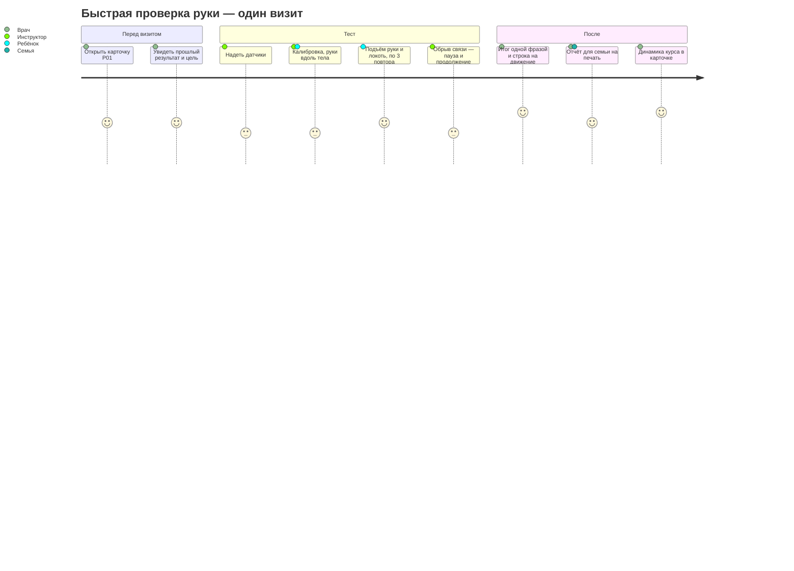

# NeuroMove — продукт: для кого, зачем, как проверить спрос

Состояние на 1 октября 2026. Опора — питч команды (`питч/`), письмо поддержки
реабилитолога «Aspasia» (15 сентября), задания трекера (`трекер.md`, КФУ и SMART v2),
исследование (`docs/RESEARCH.md`). Каждое утверждение помечено: **факт** (есть источник),
**гипотеза** (проверяем), **неизвестно**.

Рабочий документ команды, а не текст наружу: для трекера и жюри его переписывают своими словами
(правило «документы наружу — обычным языком»).

---

## 1. Позиция в одной фразе

NeuroMove — прибор для кабинета реабилитации: лёгкие датчики на руках ребёнка с ДЦП и приложение,
которое за быструю проверку показывает объём движения в градусах, разницу сторон и помощь корпусом,
а за курс — изменение. Он дополняет шкалы врача и не ставит диагноз.

Объяснимое отличие (гипотеза, `docs/RESEARCH.md`, раздел 3): не точность — её ещё не доказали на людях, —
а фокус. Рука ребёнка с ДЦП, работа без интернета, казахский и русский, открытые формулы, отчёт для
семьи, дешёвые модули.

## 2. Пользователи

| Кто | Что известно | Статус | Задача (JTBD) | Что мешает сейчас | Что нужно для доверия |
|---|---|---|---|---|---|
| **Врач-реабилитолог** | письмо «Aspasia»: оценка в основном ручная и визуальная, нужны углы и динамика курса | **факт** — одно письмо | понять, работает ли терапия, и вовремя её поменять | угломер ошибается на ±10–14° и сильнее между специалистами (McDowell 2000, Herrero 2011); «кажется, лучше» | открытая формула, точность против эталона, отчёт за минуту, ничего не решает за него |
| **Инструктор ЛФК, кинезиотерапевт** | роль в онбординге; проводит занятия | **гипотеза** | провести тест быстро, не отвлекаясь от ребёнка | ребёнок не стоит на месте, датчики сползают, связь рвётся | понятный порядок шагов, пауза и продолжение без потерь, крупный экран |
| **Семья ребёнка** | в питче «для родителей»; отчёт для семьи есть в приложении | **гипотеза** | увидеть, что занятия дают результат | баллы шкал непонятны, прогресс незаметен неделями | простые слова, картинка руки, «выводы делает врач», никаких обещаний |
| **Ребёнок** | экран для пациента в тесте | **гипотеза** | доиграть до конца | скучные повторы | шкала и точки повторов на экране |
| **Исследователь** | роль в онбординге | **гипотеза** | выгрузить сырые данные и проверить точность | закрытые форматы | imu-csv v1, CSV, JSON, версия алгоритма в каждом сеансе |
| **Руководитель центра** | не опрошен | **неизвестно** | решить, покупать ли и где хранить данные | цена, закон о персональных данных, нагрузка на врачей | пилот с цифрами, ответ на ст. 12 закона № 94-V |

## 3. Главный путь — то, что работает в демо

Экран за экраном: «Попробовать демо» → карточка P01 → «Новый тест» → «Надеть датчики» → «Начать тест»
→ тест вживую → отчёт → карточка с обновлённой динамикой → все пациенты. Пройден сквозными тестами
на компьютере и телефоне (`docs/TEST_REPORT.md`).

## 4. Что продукт обещает и чего нет

| Обещает | Не обещает |
|---|---|
| угол в градусах по каждому повтору, сравнение сторон, наклон корпуса, плавность SPARC | диагноз, прогноз, рекомендации по лечению |
| динамику по курсу против своих же прошлых сеансов | сравнение с «нормой для возраста» — без проверенных норм их не показываем |
| работу без интернета, данные на компьютере клиники | облако, синхронизацию, вход по паролю — пока нет |
| точность на стенде не хуже 5° — **цель**, проверяется в SMART v2 | доказанную точность на детях |

## 5. Выход на рынок — гипотезы

| Гипотеза | Как проверить | Порог «подтверждено» — записан до проверки |
|---|---|---|
| Первый клиент — реабилитационный центр, а не семья | 5 интервью с центрами: кто платит за оборудование | 3 из 5 называют бюджет или закупку оборудования как путь |
| Врачу важнее динамика курса, чем разовый замер | сценарий «110°, 111°, 109°, наклон 6° → 12°» (вопрос 6 в `трекер.md`) | 3 специалиста называют одно и то же решение |
| Значимая для врача прибавка больше ошибки прибора | вопрос 7 в `трекер.md` | медиана ответов больше 5° |
| Отчёт для семьи повышает доверие родителей к занятиям | 5 родителей смотрят отчёт P01 | 4 из 5 своими словами пересказывают, что изменилось |
| Тест помещается в визит | хронометраж на добровольцах и в пилоте | надеть датчики и пройти быструю проверку — не больше 15 минут |

Финансов в этом документе нет сознательно: ни цены, ни спроса не проверяли. Единственная проверенная
цифра — себестоимость стенда: **14 850–18 850 ₸** за одну руку на проводах (`прототип.md`,
цены AmperMarket 29 сентября). Беспроводной блок — около 5–9 тыс. ₸ за датчик, оценка там же.

## 6. Эксперименты и интервью — до 11 декабря

| # | Что | Кто | Когда | Результат пишем как есть |
|---|---|---|---|---|
| E1 | Станок: две рейки на петле и транспортир, углы 0–120° | Санжар, Амирхан | после сборки стенда | средняя ошибка, максимальная, по каждому углу |
| E2 | 10 здоровых добровольцев × 3 повтора против гониометра | команда | ноябрь | средняя ошибка и ±1.96 SD (Бланд — Альтман) |
| E3 | Повтор с переодеванием датчиков через 10 минут | команда | ноябрь | разница ROM и симметрии |
| E4 | Интервью с 3–5 специалистами по сценарию отчёта | Малика, команда | октябрь | решение, значимая прибавка, готовность к пилоту |
| E5 | Показ демо родителям (без детей, без данных) | команда | октябрь — ноябрь | понятно ли без врача |
| E6 | Хронометраж «надеть — тест — снять» | команда | после E1 | минуты |

## 7. Вопросы для интервью

**Специалисту:**
1. Каких детей вы смотрите чаще всего: возраст, форма ДЦП, уровни GMFCS и MACS?
2. Как вы сейчас оцениваете руку и как часто? Сколько это занимает?
3. Когда в последний раз вы поменяли программу занятий? По какому признаку?
4. Покажу отчёт: что вы сделаете, если видите плато три сеанса подряд? А если вырос наклон корпуса?
5. На сколько градусов должен измениться подъём руки, чтобы вы поверили, что это не ошибка замера?
6. Что из отчёта вы показали бы родителям, а что нет?
7. Кто в центре решает про новое оборудование и про хранение данных?
8. Готовы ли проверить прототип на своих пациентах в январе — марте? Что для этого нужно от нас?

**Родителю (на демо-пациенте, без своих данных):**
1. Перескажите своими словами, что изменилось у ребёнка из отчёта.
2. Что в отчёте лишнее или непонятное?
3. Что вы хотели бы видеть после каждого занятия?
4. Как бы вы отнеслись к датчикам на ребёнке во время занятия?

**Руководителю центра:**
1. Где сейчас хранятся данные пациентов и кто это решает?
2. Как центр закупает оборудование и за сколько месяцев?
3. Что должно быть в пилоте, чтобы вы решили продолжать?

## 8. Структура питча — 10 слайдов

| # | Слайд | Что на нём — только проверенное |
|---|---|---|
| 1 | Проблема | врач видит «кажется, лучше»; угломер ошибается на ±10–14° (McDowell 2000) |
| 2 | Для кого | дети с ДЦП на курсе реабилитации; 1.6 на 1000 живорождённых в странах с высоким доходом (McIntyre 2022); цифра по Казахстану — со ссылкой или «около 19 тысяч» |
| 3 | Решение | датчики на груди, плечах и предплечьях → угол, симметрия, помощь корпусом |
| 4 | Демо вживую | тест на симуляторе, обрыв связи и продолжение, отчёт |
| 5 | Отчёт врачу и семье | одна фраза, три показателя, «выводы делает врач» |
| 6 | Чем отличаемся | фокус на руке ребёнка, без интернета, KZ/RU, открытые формулы; аналоги названы (K-Move, Opal, OpenCap) |
| 7 | Как проверяем точность | станок, добровольцы, повтор — пороги до замера |
| 8 | Стоимость | стенд 14 850–18 850 ₸ на одну руку |
| 9 | Команда и партнёр | роли; письмо поддержки — как поддержка, а не договор о пилоте |
| 10 | Что дальше | пилот 5–10 детей с согласием родителей и этическим комитетом |

Не говорить: «первые в Казахстане», «диагностика ДЦП», «экономит время врача», «MotorScore»
без формулы (`README.md`, раздел 6).
