# NeuroMove — архитектура

Состояние на 1 октября 2026. Всё, что ниже без пометки, **есть в коде** — у каждой диаграммы указаны
файлы. Помеченное **ПРЕДЛОЖЕНИЕ** — план, которого в коде нет.

Диаграммы — Mermaid: GitHub рисует их прямо в этом файле. Синтаксис проверен рендером Mermaid 11
в Chrome (см. `docs/TEST_REPORT.md`).

| # | Диаграмма | Что показывает |
|---|---|---|
| 1 | Контекст | кто пользуется и с чем связано приложение |
| 2 | Модули | слои кода и направление зависимостей |
| 3 | Поток данных | от сырых чисел датчика до отчёта |
| 4 | Граница с устройством | интерфейс `NeuroMoveDevice`, реализации, путь байтов с USB |
| 5 | Состояния | контроллер теста, движок сеанса, связь с устройством |
| 6 | Последовательности | живой тест, обрыв связи, загрузка архива, повтор записи, проверка точности на стенде |
| 7 | Данные | сущности IndexedDB и связи |
| 8 | Развёртывание | три способа запуска |
| 9 | Границы доверия | откуда приходят чужие данные и куда уходят наши |
| 10 | ПРЕДЛОЖЕНИЕ: сервер | как добавить учётные записи и синхронизацию |

---

## 1. Контекст

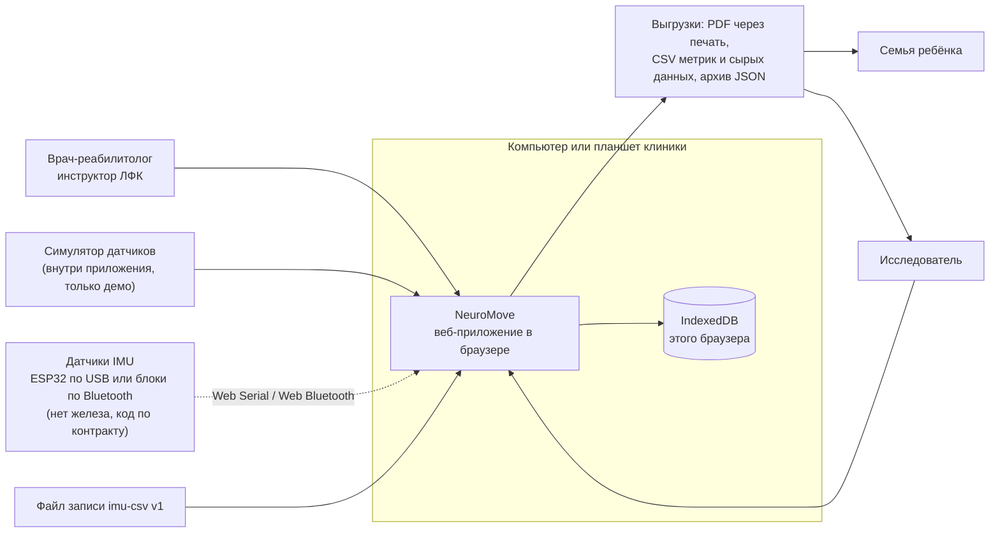

Сервера нет: приложение — статические файлы, данные — в браузере компьютера клиники.
Семья видит не приложение, а распечатанный «Отчёт для семьи».

## 2. Модули

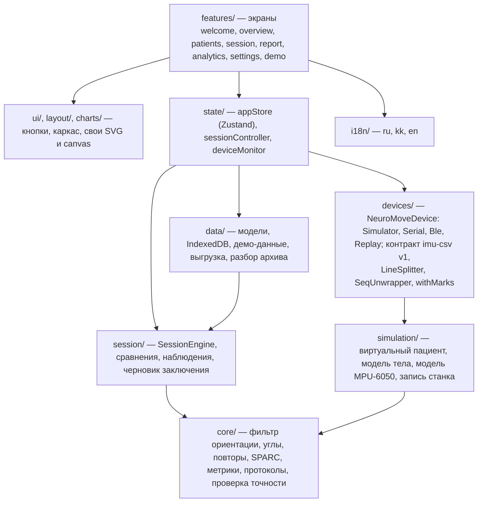

Правило: `core/`, `devices/`, `session/`, `simulation/` не знают про React — их можно перенести в Node
или в лабораторию на Python один в один (тесты Vitest гоняют их без браузера).

## 3. Поток данных

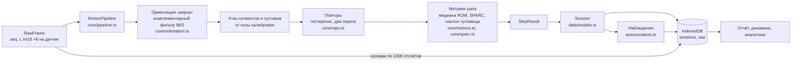

Углы и метрики считает приложение, а не устройство: прошивке достаточно отдавать сырые числа.
Те же функции строят демо-историю: виртуальный пациент «выполняет» тест, модель выдаёт сырые числа,
движок считает метрики (`data/seed/demo.ts`).

## 4. Граница с устройством

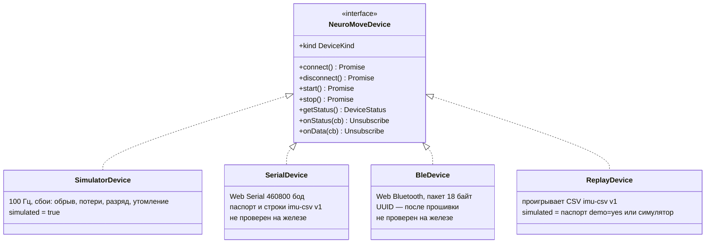

Контракт с железом — `devices/contract.ts` и `софт.md`, раздел 1. Новое железо —
ещё один класс с этим интерфейсом; экраны, движок и отчёты не меняются.

Путь байтов с USB до отсчёта. По ту сторону кабеля — прошивка стенда
([`firmware/`](../../../firmware/README.md)): 100 раз в секунду 14 байт с каждого MPU-6050
и строка imu-csv v1; паспорт повторяется каждые 2 с.

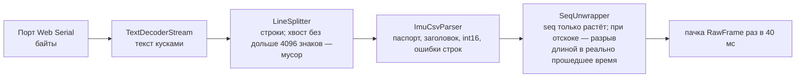

## 5. Состояния

### 5.1. Контроллер теста — `state/sessionController.ts`

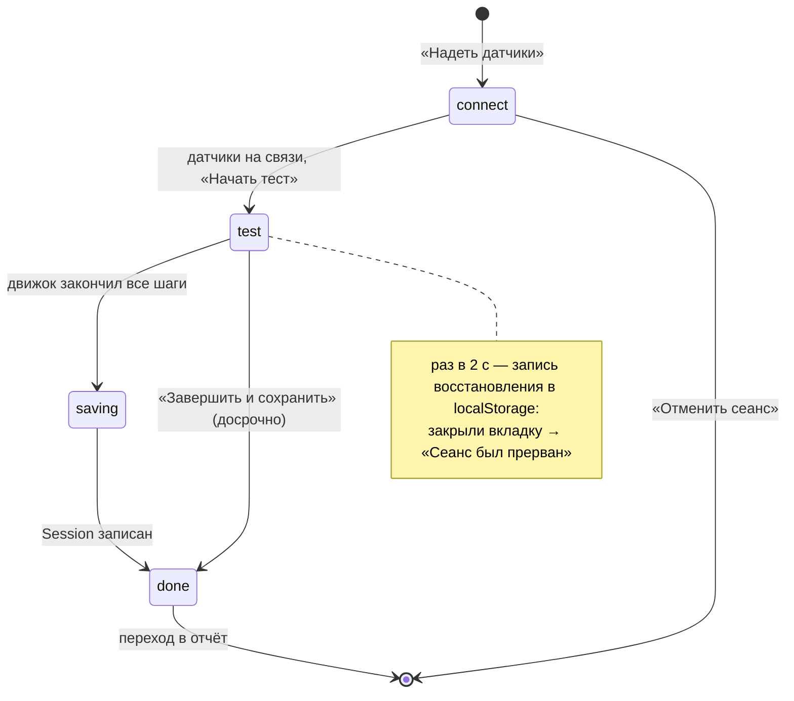

### 5.2. Движок сеанса — `session/SessionEngine.ts`

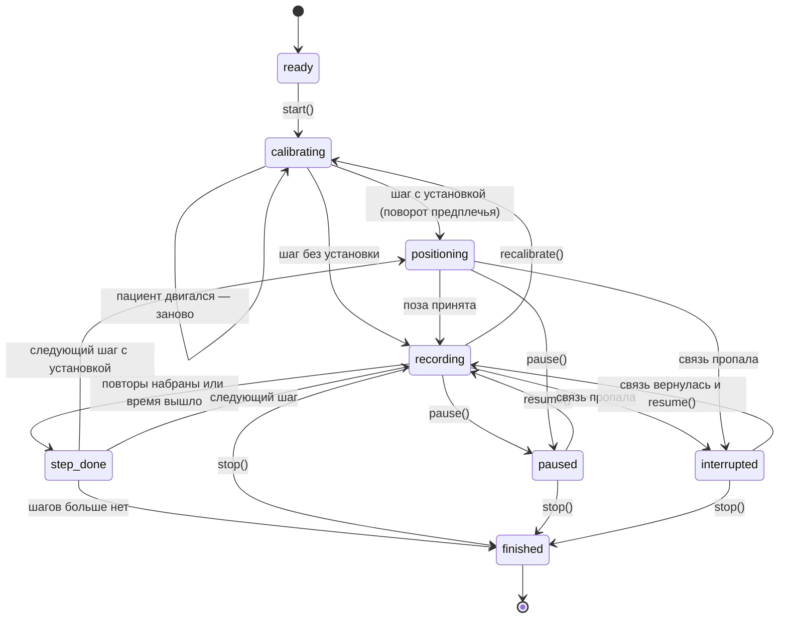

Прерванный повтор не засчитывается: при паузе и обрыве детектор повторов сбрасывается.

### 5.3. Связь с устройством — `devices/types.ts`

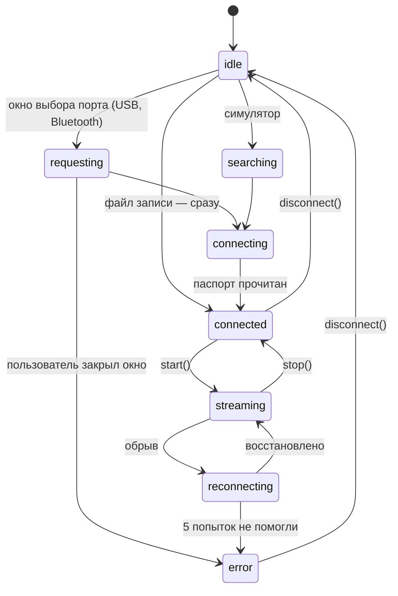

## 6. Последовательности

### 6.1. Живой тест и сохранение

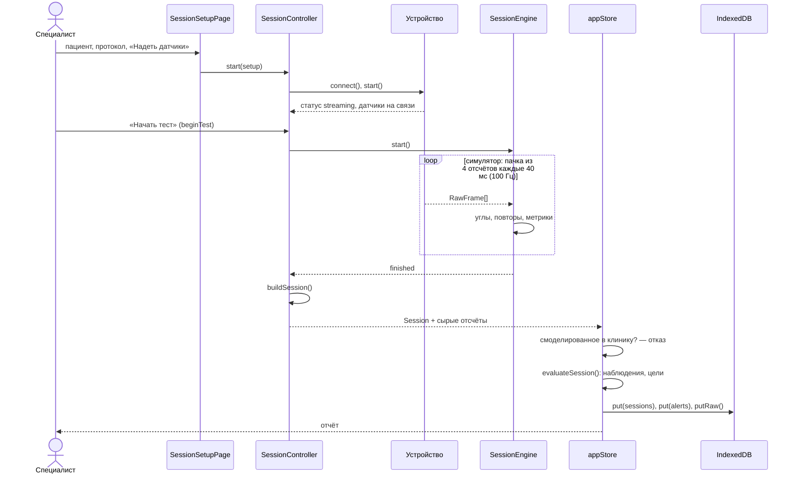

### 6.2. Обрыв связи

```mermaid
sequenceDiagram
  participant D as Устройство
  participant E as SessionEngine
  participant O as InterruptionOverlay
  actor U as Специалист
  D-->>E: статус reconnecting
  E->>E: recording → interrupted, текущий повтор выброшен
  E-->>O: «Связь с устройством потеряна»
  D->>D: до 5 попыток переподключения
  D-->>E: статус streaming
  E-->>O: «Связь восстановлена»
  U->>O: «Продолжить»
  O->>E: resume()
  E->>E: interrupted → recording
```

### 6.3. Загрузка архива JSON

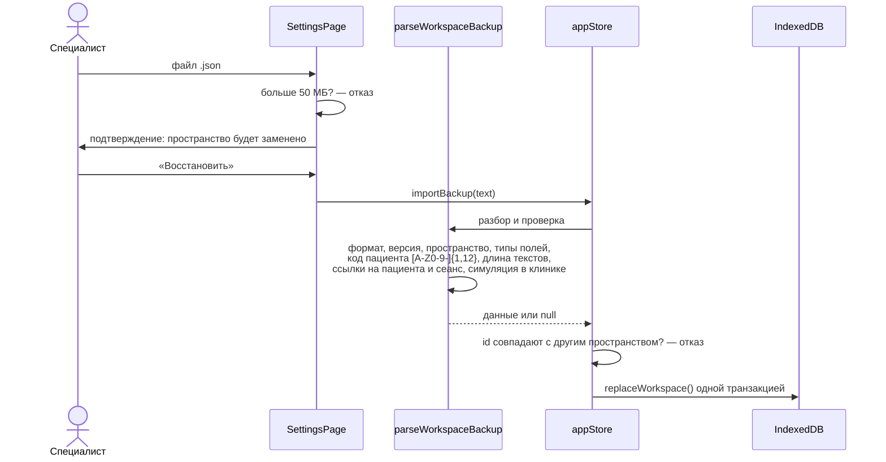

### 6.4. Повтор записи в пространстве клиники

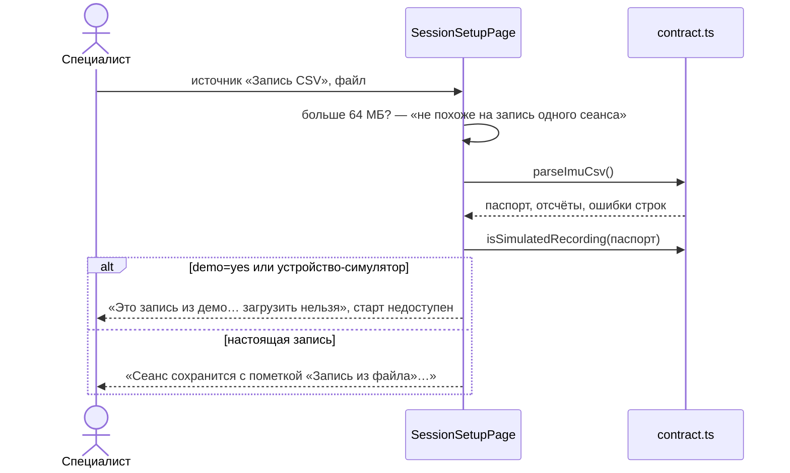

### 6.5. Проверка точности на стенде

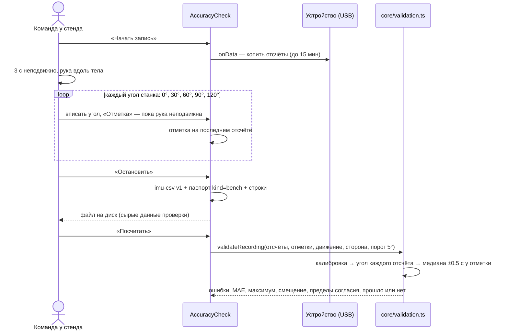

## 7. Данные — IndexedDB `neuromove`, версия 1

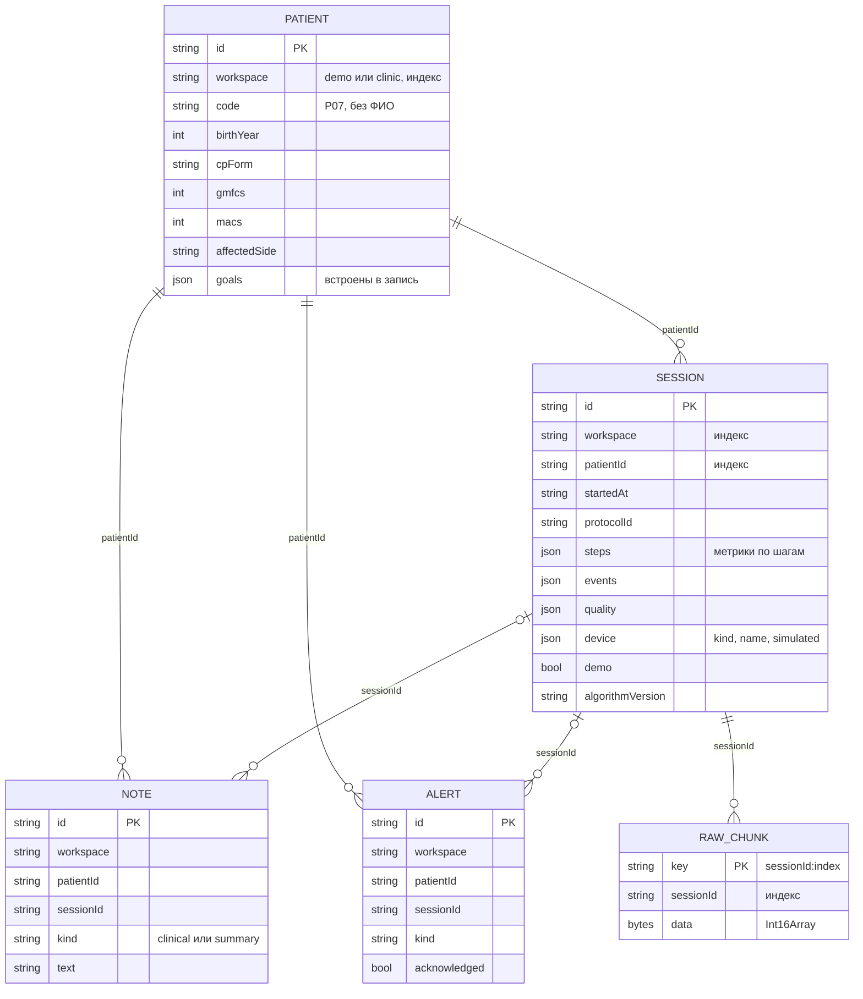

Ещё хранилище `meta` (ключ — значение): настройки, профиль специалиста, служебная запись демо
и снимок демо для мгновенного сброса. Схема и индексы — `data/db.ts`; проверка архива —
`data/backup.ts`.

**Миграции.** Версия базы — 1. Новая версия: поднять `DB_VERSION` и дописать ветку в `upgrade(db, oldVersion)`
— только добавлять хранилища и индексы, ничего не удалять. Перед обновлением — архив JSON
из «Настроек». Откат: старая версия приложения не откроет базу новой версии; восстановление —
архив JSON в чистом браузере.

## 8. Развёртывание

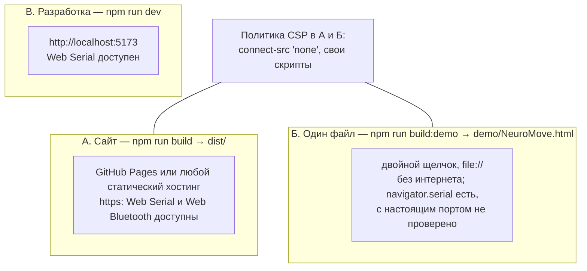

Chrome считает страницу с диска защищённым контекстом: `isSecureContext === true`, `navigator.serial`
и `navigator.bluetooth` есть (проверено 1 октября в Chrome через Playwright). Подключение настоящего
порта с диска не проверено — железа нет. Подробности и порядок выпуска — `docs/DEPLOYMENT.md`.

## 9. Границы доверия

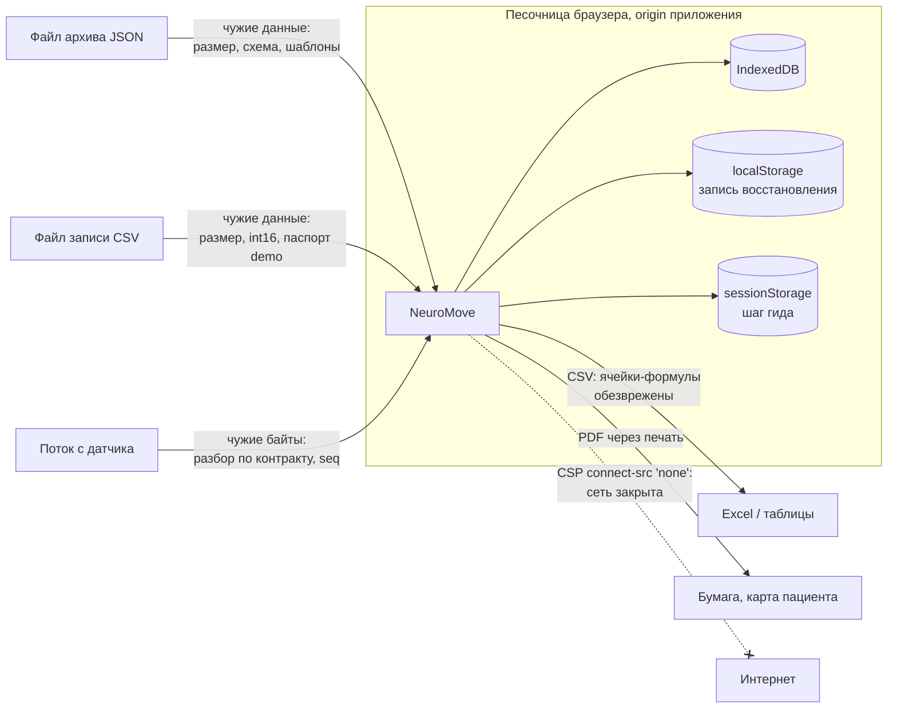

Что не закрыто — `docs/SECURITY_PRIVACY.md`: нет пароля и шифрования на диске; на GitHub Pages все
проекты одного аккаунта делят один origin, а значит, и IndexedDB.

## 10. ПРЕДЛОЖЕНИЕ: сервер

Этого нет в коде. Порядок и условия — `docs/ROADMAP.md`.

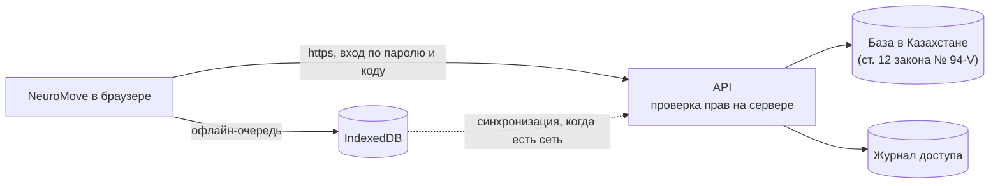

Условия до начала: где можно хранить данные детей (юрист центра), кто владелец данных, роли
(врач, инструктор, исследователь), срок хранения. Реализация хранилища — новый класс с интерфейсом
`DataStorage` (`data/db.ts`); экраны не меняются.
