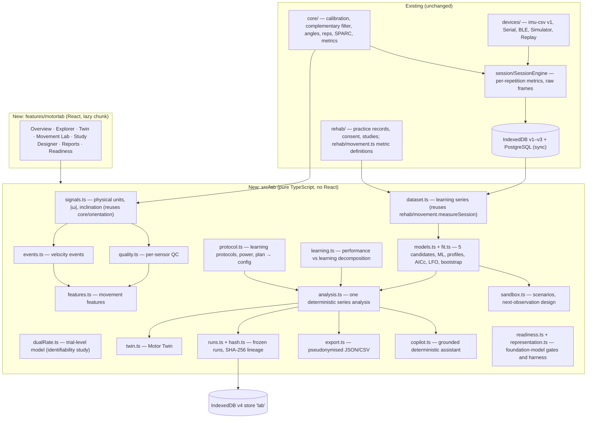

# Computational motor-learning lab — architecture

Added on 8 November 2026 on top of the existing platform. Nothing existing was replaced. Hardware and firmware were not touched.

## 1. Layers

**Rules:**
- **Computation is pure and deterministic.** `src/lab` imports no React; every random draw is seeded; the same code runs in the browser and in Node tests.
- **The computation engine owns every number.** The UI and the assistant only display and select.
- **No new orientation algorithm.** The lab reuses the existing complementary filter, unit conversion and SPARC, and the per-repetition metrics that `core/metrics.ts` stored in each session.
- **Lazy loading.** The UI is a separate build chunk (`MotorLabRoute`, about 117 kB), so the existing workspace chunk does not grow.

## 2. Routes

| Route | Page |
|---|---|
| `#/research/lab` | Research overview: longitudinal coverage, quality, raw availability, runs |
| `#/research/learning?p=&task=&metric=` | Motor Learning Explorer |
| `#/research/twin/:participantId` | Computational Motor Twin |
| `#/research/movement[/:sessionId]` | Movement Analysis Lab (stored raw or imu-csv file) |
| `#/research/designer` | Study Designer (learning protocols) |
| `#/research/runs`, `#/research/runs/:id` | Research reports (frozen runs) |
| `#/research/readiness` | Foundation-model readiness |

## 3. Storage

**IndexedDB schema v4 (additive).**
- It adds one store, `lab` (keyPath `id`; indexes workspace, kind, participantId), for `learning_protocol` versions and `analysis_run` records.
- Earlier stores are untouched; `src/data/storage.test.ts` tests v3 → v4.

**Lab records are local to the browser in this version.** They are not part of team sync: no outbox ops, no server table. Reasons:
- frozen runs are derived data, reproducible from their own snapshot;
- adding a synced entity requires a server migration, validators and the API bundle, which is the next step;
- the UI says "stored on this device".

**Write path.**
1. A pure builder runs (`makeVersion`, `createRun`).
2. `putResearch('lab', …)` writes the record.
3. Only then does the in-memory state change.

A protocol version may change only its status (draft → frozen → archived, `canTransition`); a frozen definition never changes.

## 4. Privacy and AI boundary

- The assistant is deterministic. No language model is called, and nothing is sent anywhere.
- `copilot.evidencePacket()` defines a future integration boundary: de-identified, aggregated facts only. Using it with an external model requires explicit configuration and a privacy review. The existing optional Gemini route for rehab summaries is not used by the lab.
- Exports are pseudonymised by default (participant and session pseudonyms, study days).

## 5. Decisions

| Decision | Choice | Alternative rejected | Why |
|---|---|---|---|
| Where to compute | Browser (pure TS) | Python service | Offline-first app, no server dependency for analysis, same code in tests; exports allow Python/R re-analysis |
| Estimation | ML + profile likelihood + parametric bootstrap | MCMC / hierarchical Bayes | Too few participants for justified priors; deterministic and fast; honest intervals |
| σε | Two-stage pooled estimate | Joint estimation | Many more degrees of freedom; comparable likelihoods across models; propagated in the bootstrap |
| Twin scope | Per task × metric statistical models | Musculoskeletal or "neural" simulation | Not observable with 3 IMUs; would overclaim |
| Persistence of results | Frozen immutable runs with hashes | Recompute on view | Algorithm changes must not rewrite history |
| Hash stability | Results rounded to 8 significant digits, versioned hash scheme | Exact bytes | Last-bit floating-point differences between JS engines |
