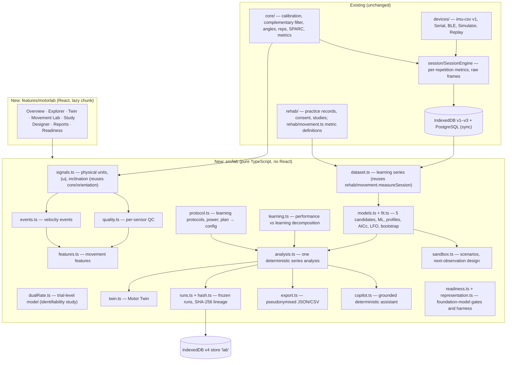

# Computational motor-learning lab — architecture

Added on 8 November 2026 on top of the existing platform. Nothing existing was replaced. Hardware and firmware were not touched.

## 1. Layers

**Rules:**
- **Computation is pure and deterministic.** `src/lab` imports no React; every random draw is seeded; the same code runs in the browser and in Node tests.
- **The computation engine owns every number.** The UI and the assistant only display and select.
- **No new orientation algorithm.** The lab reuses the existing complementary filter, unit conversion and SPARC, and the per-repetition metrics that `core/metrics.ts` stored in each session.
- **Lazy loading.** The UI is a separate build chunk (`MotorLabRoute`, about 117 kB), so the existing workspace chunk does not grow.

## 2. Routes

| Route | Page |
|---|---|
| `#/research/lab` | Research overview: longitudinal coverage, quality, raw availability, runs |
| `#/research/learning?p=&task=&metric=` | Motor Learning Explorer |
| `#/research/twin/:participantId` | Computational Motor Twin |
| `#/research/movement[/:sessionId]` | Movement Analysis Lab (stored raw or imu-csv file) |
| `#/research/designer` | Study Designer (learning protocols) |
| `#/research/runs`, `#/research/runs/:id` | Research reports (frozen runs) |
| `#/research/readiness` | Foundation-model readiness |

## 3. Storage

**IndexedDB schema v4 (additive).**
- It adds one store, `lab` (keyPath `id`; indexes workspace, kind, participantId), for `learning_protocol` versions and `analysis_run` records.
- Earlier stores are untouched; `src/data/storage.test.ts` tests v3 → v4.

**Record kinds in `lab`:**

| Kind | Purpose |
|---|---|
| `learning_protocol` | study protocol versions |
| `analysis_run` | frozen analyses |
| `practice_trials` | one sitting of child-mode practice: each repetition's peak, target and validity |
| `trial_recording` | a professional's decision to record practice trials for a participant (append-only; newest wins) |

**Team sync (added 8 November, second pass).** Lab records travel as the sync entity `lab_record`, stored server-side in `nm_lab_records` (migration `0003_lab`).

- **One shared validator.** `src/lab/integrity.ts` is dependency-light and runs in the browser, on pulled changes and on the server. It checks shape **and hashes**:
  - a protocol whose definition no longer matches `defHash` is refused;
  - so is a run whose snapshot, configuration or results no longer match their hashes;
  - so is a practice-trial set whose `contentHash` is wrong.
- **Immutability, also against direct SQL.** A trigger enforces that runs, trial sets and recording settings never change, and that a protocol keeps its definition and moves only draft → frozen → archived. Records are never deleted.
- **Demo and simulated content never reach the server.** Both browser and server refuse them.
- **Caregiver accounts** may push only `practice_trials` of a linked child, and pull only that child's `trial_recording` and `practice_trials`. Everything else in the lab is withheld.
- **Tests:** `server/lab.test.ts` (PGlite), `src/lab/practice.test.ts`.

**Write path** (`features/motorlab/store.ts`; for practice trials, `lab/practice.ts`, used by child mode):
1. A pure builder runs (`makeVersion`, `createRun`, `trialSetFromEngine`).
2. The integrity check runs, plus the transition rule for updates.
3. The record and, in the clinic workspace, its outbox op are written in **one** IndexedDB transaction.
4. Only then does the in-memory state change.

**Practice-trial recording.** It is consent-gated (`trialRecordingStatus`). In the clinic it requires both:
- the newest `trial_recording` setting is enabled;
- an active study consent for the participant exists.

The adult on the child's device sees "Practice trials are recorded for the study — not a clinical measurement". The Twin page shows the switch and fits trial-level models (`fitTargetedPractice`): no learning, single-rate, and fast + slow.

## 4. Privacy and AI boundary

- The assistant is deterministic. No language model is called, and nothing is sent anywhere.
- `copilot.evidencePacket()` defines a future integration boundary: de-identified, aggregated facts only. Using it with an external model requires explicit configuration and a privacy review. The existing optional Gemini route for rehab summaries is not used by the lab.
- Exports are pseudonymised by default (participant and session pseudonyms, study days).

## 5. Decisions

| Decision | Choice | Alternative rejected | Why |
|---|---|---|---|
| Where to compute | Browser (pure TS) | Python service | Offline-first app, no server dependency for analysis, same code in tests; exports allow Python/R re-analysis |
| Estimation | ML + profile likelihood + parametric bootstrap | MCMC / hierarchical Bayes | Too few participants for justified priors; deterministic and fast; honest intervals |
| σε | Two-stage pooled estimate | Joint estimation | Many more degrees of freedom; comparable likelihoods across models; propagated in the bootstrap |
| Twin scope | Per task × metric statistical models | Musculoskeletal or "neural" simulation | Not observable with 3 IMUs; would overclaim |
| Persistence of results | Frozen immutable runs with hashes | Recompute on view | Algorithm changes must not rewrite history |
| Hash stability | Results rounded to 8 significant digits, versioned hash scheme | Exact bytes | Last-bit floating-point differences between JS engines |
