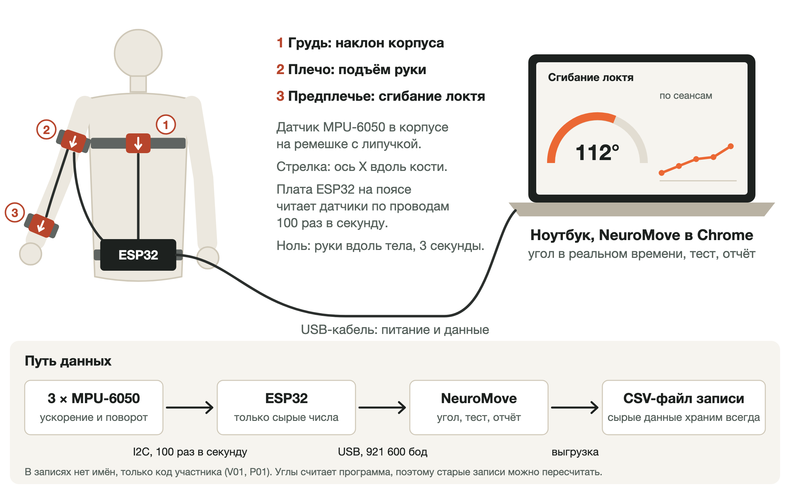

# NeuroMove — схема простейшего прототипа (v0)

Это ранний черновик схемы прототипа и технических рисков, составленный в сентябре 2026 года.
Текущие CAD-модели, схемы подключения и инструкции по сборке находятся в [`hardware/`](hardware/README.md);
актуальный контракт данных описан в [`софт.md`](софт.md).

---

## 1. Что это

- **Одна рука, три датчика:** грудь, плечо, предплечье. Провода к одной плате ESP32
  (классическая DevKit, куплена 9 октября), от неё USB к ноутбуку. Это способ А
  из [`железо.md`](железо.md), раздел 3.
- **Что меряет:** подъём руки вперёд и в сторону, сгибание локтя, наклон корпуса
  во время подъёма руки — компенсацию.
- **Зачем:** доказать, что угол считается точно и повторяемо, — на станке, на себе
  и на здоровых добровольцах. И живая демонстрация 11 декабря: датчик на руке → отчёт на экране.
- ⚠️ **Не для детей.** Провода на ребёнке — нельзя. Для пилота — беспроводная версия v1
  (раздел 8), и только после того, как v0 прошёл проверку точности.



Исходник картинки — [`прототип-схема.svg`](прототип-схема.svg), правится как текст.
PNG пересобирается из папки `` на маке:

```bash
"/Applications/Google Chrome.website/Contents/MacOS/Google Chrome" --headless=new --disable-gpu --hide-scrollbars --force-device-scale-factor=1.5 --window-size=1600,1000 --screenshot="$PWD/прототип-схема.png" "file://$PWD/прототип-схема.svg"
```

## 2. Компоненты и стоимость

| # | Что | Сколько | Цена, ₸ | Зачем |
|---|---|---|---|---|
| 1 | ✅ Плата ESP32 DevKit: ESP32-WROOM-32, CH340C, USB Type-C, 30 выводов | 1 | 3 498 — куплена | две шины I2C; читает три датчика 100 раз в секунду, шлёт в ноутбук по USB |
| 2 | ✅ MPU-6050, модуль GY-521: акселерометр и гироскоп | 4: три и запасной | 3 528 — по 882, куплены | грудь, плечо, предплечье |
| 3 | Кабель: старые USB-кабели с передачей данных — внутри 4 жилы, круглые, не толще 4,6 мм | 2–3 по 1 м | 0 — есть дома | шина I2C: питание, земля, SDA, SCL; уйдёт около 1,5 м |
| 4 | [Провода мама-мама 20 см, 10 шт.](https://ampermarket.kz/wires/mama-mama-20cm/) — разрезать, гнёзда надеваются на выводы платы | 2 упаковки | 350 | кабель к плате без пайки к плате |
| 5 | [Термоусадка 1 м](https://ampermarket.kz/soldering/insulators/shrink-tube-1-meter/): 2 мм и 6 мм | по 1 м | 470 | изоляция пайки и концов кабеля |
| 6 | [Липучка рулоном 5 м × 20 мм](https://kaspi.kz/shop/p/kabel-naja-stjazhka-odin-rulon-5000-20-mm-166360558/?c=710000000), липнет сама к себе | 1 | 995 | ремешки на плечо, предплечье и грудь |
| 7 | Корпуса, 3D-печать | 3 | 1 000–1 200 — по сайту 3dmod.kz, не уточнено | модуль не болтается; прорезь под ремешок; стрелка оси X |
| 8 | Станок: две рейки на петле и транспортир | 1 | 500–1 000, оценка | угол известен заранее — проверка формулы без людей |
| 9 | Гониометр | 1 | 0 — взять у реабилитолога | эталон на добровольцах |
| 10 | Ноутбук с Chrome; кабель USB-A → USB-C с передачей данных, лучше 1,5–2 м | 1 | 0 — есть | питание платы и данные |
| | **Итого** | | **10 340–11 040**, из них куплено 7 026 | |

- **Куплено 9 октября на Kaspi:** плата — продавец MILTECH, 3 498 ₸; четыре GY-521 — продавец
  Alash Electronics, по 882 ₸. Вместо ESP32-S3 N16R8 (6 500 ₸, выбор 29 сентября) взяли классический
  ESP32 DevKit: две шины I2C у него тоже есть, прошивка собирается и для него, а 16 МБ флеша
  и 8 МБ PSRAM у S3 прошивке не нужны. Проверено 7 октября: сборка `esp32dev` без предупреждений,
  память 7%, флеш 24%; 108 проверок прошивки и 240 тестов приложения проходят; на фото платы
  выводы 21, 22, 32, 33, 3V3 и GND на месте. Цены строк 4–6 сверены 9 октября, строки 7–8 — нет.
- **Чтобы не покупать дважды** (проверено по корпусу `hardware/models/enclosure/korpus_v3.py`):
  - гребёнки к модулям не паять: корпус высотой 9,2 мм рассчитан на плоскую плату, провода
    паяются прямо в отверстия модуля;
  - ремешок не шире 30 мм — такая прорезь у корпуса; 4–5 см не пролезут;
  - кабель круглый и не толще 4,6 мм — под паз корпуса. Плоский 4-жильный шлейф из AmperMarket
    не ляжет. Корпуса печатать последними: сначала спаять кабель, замерить его толщину и вписать
    в `cable_d`, посмотреть, куда на модуле смотрит стрелка X (`x_along`);
  - кабель USB-C ↔ USB-C плату может не запитать: у дешёвых плат с Type-C часто нет резисторов
    на линиях CC. Нужен USB-A → USB-C;
  - мультиметр и паяльник — из мастерской Армана; нет мультиметра — DT-838 в AmperMarket, 2 500 ₸.
- **Почему не C3 на стенд.** У MPU-6050 два адреса, 0x68 и 0x69: на одной шине I2C —
  не больше двух датчиков. У классического ESP32 и у ESP32-S3 две шины I2C, у ESP32-C3 — одна
  (ESP-IDF, раздел I2C:
  [S3](https://docs.espressif.com/projects/esp-idf/en/stable/esp32s3/api-reference/peripherals/i2c.html),
  [C3](https://docs.espressif.com/projects/esp-idf/en/stable/esp32c3/api-reference/peripherals/i2c.html)).
  Третий датчик на C3 — только через мультиплексор I2C.
- **ESP32-C3 Super Mini** — [1 900 ₸](https://ampermarket.kz/boards/esp/esp32-c3-super-mini-weld/),
  22,5 × 18 мм — Малика предложила её для пилота. Для беспроводного блока v1 она подходит:
  датчик в блоке один, одной шины хватает. Зарядки LiPo на плате нет (в описании магазина
  её нет) — нужен модуль зарядки с защитой; это вопрос 8 инженеру.
- **Школьная мастерская — сначала проверить, потом покупать** (3 октября). У инженера-консультанта
  Армана Жубатханова в подвале школы много Arduino, Raspberry Pi, датчиков и устройств для проектов;
  под вопросом только датчики движения. Что подойдёт для стенда:
  - плата — любая ESP32 с двумя шинами I2C: ESP32-S3 или классический ESP32 DevKit. Прошивка
    собирается для обеих. Arduino Uno и Nano не подойдут: прошивка использует память и вторую шину
    I2C, которые есть только у ESP32, а у Uno одна шина — не больше двух MPU-6050 без мультиплексора.
    Raspberry Pi — это другой путь: прошивку пришлось бы писать заново;
  - датчики — MPU-6050 (модули GY-521) подходят без правок. MPU-6500 и MPU-9250 прошивка увидит,
    но фильтр акселерометра у них настраивается другим регистром — нужна небольшая правка.
    Другим моделям (BNO055, LSM6DS3, BMI160 и т. п.) нужен свой драйвер;
  - провода, макетные платы, паяльник, мультиметр, 3D-принтер: всё, что найдётся, убирает строки
    «оценка» из сметы. Если найдутся плата и три MPU-6050, стенд почти ничего не стоит.
- Бюджет раннего прототипа — 25 тыс. ₸ (оценка из первоначального трекера). Стенд со всеми строками —
  около 11 тыс. ₸, остаток — около 14 тыс. ₸: это **один пробный беспроводной блок** v1 — раздел 8.
  На нём проверяем Bluetooth и батарею до того, как покупать комплект.
- Почему MPU-6050, а не BMX055 из питча (слайд 6, 10 800 ₸): девятая ось — магнитометр,
  а в зале реабилитации он врёт рядом с металлом — кровати, коляски, тренажёры. Для угла
  в суставе он не нужен. Решает Санжар; это вопрос 1 инженеру.

## 3. Крепление

| Датчик | Где | Чем |
|---|---|---|
| 1 — грудь | грудина, по центру | ремень вокруг груди из липучки 20 мм |
| 2 — плечо | наружная сторона плеча, посередине между плечевым суставом и локтем | ремешок из липучки 20 мм: прорезь корпуса — 30 мм, шире не пройдёт |
| 3 — предплечье | тыльная сторона, ближе к запястью: там меньше мышц, датчик меньше ездит | ремешок из липучки 20 мм |
| ESP32 | пояс спереди | в корпусе на поясном ремне |

- **Ось X — вдоль кости, к кисти.** На корпусе стрелка. На обеих руках — одинаково.
- **Корпус** около 4 × 3 × 1,5 см, скруглённые края, модуль на винтах. Провод прихвачен
  стяжкой у корпуса: рывок тянет корпус, а не пайку.
- **Метка маркером** на коже или рукаве — куда ставить датчик. Иначе повторный тест мерит
  не руку, а то, как надели.
- **Ноль перед каждым тестом:** сидя, руки вдоль тела, 3 секунды неподвижно
  ([`софт.md`](софт.md), «Калибровка»).
- **Цель:** надеть три датчика за 2 минуты.

## 4. Запись данных

```
MPU-6050 ×3 ──I2C, 100 раз в секунду──▶ ESP32 ──USB, текст CSV, 460 800 бод──▶ ноутбук
                                                                                  │
                           веб-приложение в Chrome (Web Serial): живой угол, тест, отчёт
                                                                                  │
                     сырой CSV с паспортом записи → хранилище браузера → выгрузка файлом
```

- **Плата ничего не считает.** Она шлёт сырые числа — ускорение и поворот по трём осям
  с каждого датчика — и номер отсчёта. Углы считает софт: поправили формулу — перепрошивать
  не надо, старые записи пересчитываются.
- **Формат — `imu-csv v1`**, [`софт.md`](софт.md), раздел 1: паспорт в строках `#` —
  устройство, прошивка, частота, диапазоны, места датчиков, — дальше строка на отсчёт.
- **Скорость порта — 460 800 бод, не 115 200.** Строка с 19 числами — около 100–137 байт,
  100 строк в секунду — до 13,7 КБ/с. 115 200 бод пропускают не больше 11,5 КБ/с:
  на быстрых движениях отсчёты начнут теряться. 460 800 — 46 КБ/с, поток занимает 30% порта.
  Сначала было 921 600, но 12 октября на маке с купленной платой (CH340C) на 921 600 шли одни
  каракули, на 460 800 — чистый текст.
- **Номер отсчёта** показывает каждую потерю. Больше 0,1% потерь за 10 минут — шина или кабель сбоит.
- **Прошивка уже есть** (2 октября): [`firmware/`](firmware/README.md) — поток imu-csv v1, 100 Гц, поиск
  датчиков, перезапуск шины, калибровка акселерометров, команды в мониторе порта. Собирается для ESP32-S3
  и классического ESP32, проверена на компьютере с поддельными датчиками; на плате — первое, что делаем.
- **Приложение уже есть:** MVP от 26 сентября ([`website/`](website/README.md)) — подключение по USB,
  калибровка, тест, отчёт, выгрузка CSV. С настоящей платой ещё не проверено — это первое,
  что делаем, когда стенд собран.
- **Без имён.** Код участника: `V01` — доброволец, `P01` — ребёнок. Фото и видео с лицом не пишем.
- **Сырые записи не удаляются никогда** — ни удачные, ни неудачные: по ним пересчитываются
  метрики и проверяется точность.
- На проверке точности в запись ставится метка «гониометр показывает 90°»: строка
  `# mark seq=… ref=90` ([`софт.md`](софт.md), «Паспорт записи»).

## 5. Главные технические риски

| # | Риск | Чем грозит | Как проверяем на стенде | Если подтвердился |
|---|---|---|---|---|
| 1 | Датчик ездит на руке: ремешок, мышцы, кожа | угол гуляет на 5–10° от надевания к надеванию; повторный тест не совпадает | снять и надеть 5 раз, мерить один и тот же угол: разброс ≤ 5° | метки, ремешок шире, датчик предплечья ближе к запястью; калибровка движением, а не только позой |
| 2 | Ноль датчика смещён. Гироскоп в покое показывает не ноль; у акселерометра MPU-6050 заводской ноль — до ±50 мг по осям X и Y | угол сползает за 15 минут теста; наклон врёт до ~3° | станок — раздел 7, шаг 1; 10 минут махов, потом та же поза, что в начале: разница ≤ 2° | гироскоп — вычитать смещение после каждой калибровки, уже в софте; акселерометр — один раз откалибровать каждый датчик в 6 положениях, поправки хранить по номеру датчика. Сделано в прошивке (команда `cal`) и приложении: на записи станка с таким нулём ошибка до 6,5°, с поправками 0,24–0,36° (симулятор, 2 октября) |
| 3 | Шина I2C сбоит на проводе 50 см при движении | пропуски, плата зависает посреди теста | 10 минут записи с резкими движениями: пропусков < 0,1%, ни одного зависания | короче провод, 100 кГц, провода скрутить; перезапуск шины в прошивке — сделано: 10 неудач подряд — перезапуск, 3 перезапуска — датчик вне потока, пока не ответит; не помогает — плата на каждый датчик, как в v1 |
| 4 | Формула локтя верна, только когда плечо и предплечье в одной вертикальной плоскости | в других позах ошибка больше 5° | станок и добровольцы в разных позах | в тесте фиксируем позу — плечо прижато к телу; не хватает — полная 3D-ориентация, фильтр Madgwick |
| 5 | Эталон сам неточный | против гониометра не доказать точность лучше его собственной ошибки | станок с известным углом; видео сбоку, угол по видео в Kinovea — второй эталон | главная проверка — станок и здоровые добровольцы; гониометр — ориентир |

К риску 5. У детей с ДЦП ошибка гониометра между двумя замерами — ±10–14° в один день
и до ±18–28° в разные дни (замеры на ногах, 12 детей; McDowell и др., 2000). Поэтому точность
прибора проверяем не на детях, а на станке и здоровых добровольцах. И это же — довод в пользу
прибора: если он повторяет замер в пределах ±5°, врач увидит прибавку, которую гониометр
не отличает от ошибки. Это надо доказать — раздел 7.

Риски пилота, не этого прототипа: у ребёнка со спастичностью рука может не замереть
на 3 секунды калибровки; ребёнок тянет ремешки; тест дольше 15 минут. Спрашиваем
реабилитологов на интервью (по первоначальному плану).

## 6. Сроки

| Когда | Что | Кто |
|---|---|---|
| до 6 октября | разговор с инженером-консультантом Арманом Жубатхановым: что есть в школьной мастерской; схема исправлена по его замечаниям | Санжар, Амирхан — если успевает |
| 6–18 октября | стенд на столе: 2 датчика, угол локтя на экране вживую; станок | Санжар; подключение к приложению — Амирхан, 1–2 вечера |
| до 15 ноября | 3 датчика на ремешках: демонстрация на себе; показ реабилитологу | вся команда |
| до 4 декабря | проверка точности — раздел 7; результат записан, даже если не прошли | вся команда |

До школьного этапа олимпиады (окно 20 октября – 10 ноября) у Амирхана на оба проекта —
не больше 3 часов в неделю ([`../admissions/03-calendar.md`](../admissions/03-calendar.md)).
Поэтому стенд — к 18 октября: подключить его к приложению Амирхан успевает до этапа.

## 7. Как проверяем точность — способ согласовать с инженером

Критерии пишутся и коммитятся **до** первого замера — git покажет дату.

| Шаг | Как | «Прошли», если |
|---|---|---|
| 1. Станок | рейки на петле: 0°, 30°, 60°, 90°, 120°, каждый угол 3 раза | ошибка ≤ 3° на каждом угле |
| 2. Стенд на себе | 10 минут записи с махами | пропусков < 0,1%; дрейф ≤ 2° |
| 3. Добровольцы | 10 здоровых × 3 повтора: локоть и подъём руки; гониометр и видео сбоку | средняя ошибка ≤ 5° |
| 4. Повторяемость | тот же человек через 10 минут, датчики сняли и надели заново | разница ≤ 5° |
| 5. Время | надеть, откалибровать, пройти тест | ≤ 15 минут |

Почему 5°:

- гониометр сам ошибается на несколько градусов даже у здоровых — точнее 5° против него
  не проверить;
- ошибка прибора должна быть меньше прибавки, которая важна врачу: если значимая прибавка —
  10°, прибор с ошибкой ±8° её не покажет. Какая прибавка значима — спрашиваем на интервью
  (первоначальные КФУ 1 и 2).

Те же числа — в [`README.md`](README.md), раздел 8, и в [`софт.md`](софт.md), раздел 5.

## 8. Что дальше — v1 для детей

- **По блоку на датчик:** ESP32-C3 Super Mini, MPU-6050 и LiPo 300–500 мА·ч в закрытом корпусе;
  по Bluetooth к ноутбуку или через хаб по ESP-NOW — способы Б и В, [`железо.md`](железо.md),
  раздел 3. У Super Mini нет зарядки на плате — отдельный модуль зарядки с защитой.
  Запасной вариант — XIAO ESP32C3: зарядка LiPo на плате, $4.90 у производителя, цену
  в Казахстане не сверял.
- **Один блок — около 5–9 тыс. ₸:** плата 1 900, датчик 1 950, аккумулятор, модуль зарядки
  и корпус — оценка. Одна рука — 3 блока, две руки — 5.
- **Безопасность** — [`README.md`](README.md), раздел 10: только аккумулятор, закрытый корпус,
  нет мелких деталей и острых краёв, датчики на ребёнке — только при враче.

## 9. Разговор с инженером

**Инженер-консультант найден 3 октября: Арман Жубатханов** из школы Амирхана, на связи.
В подвале школы у него мастерская: много Arduino, Raspberry Pi, датчиков и устройств для проектов.
Телефон — в документе команды, в репозиторий не переносим.

**Сначала — что есть в мастерской** (5 минут, до вопросов по схеме; от ответов зависит, что покупать):

- Есть ли платы ESP32 и какие: ESP32-S3, ESP32 DevKit, ESP32-C3? Сколько штук?
- Какие датчики движения есть: MPU-6050 (GY-521), MPU-6500, MPU-9250, BNO055, BNO085,
  LSM6DS3, BMI160? Сколько штук? Для стенда нужно три одинаковых.
- Есть ли 4-жильный мягкий кабель, макетные платы, провода-дюпоны, термоусадка?
- Есть ли паяльная станция, мультиметр, 3D-принтер? Каким пластиком печатают: PLA, PETG?
- Можно ли собирать и хранить стенд в мастерской? В какие дни и часы туда можно приходить?

**Вопросы по схеме — 30–40 минут:**

1. MPU-6050 хватит для угла в локте и плече — или сразу брать датчик, который сам считает
   ориентацию (BNO085)? Нужен ли магнитометр в зале реабилитации?
2. Провод I2C до 50 см на двигающейся руке — выдержит? Что лучше: короче провод,
   экранированный кабель, расширитель шины — или сразу плата на каждый датчик?
3. 100 отсчётов в секунду, фильтр датчика 44 Гц, гироскоп ±1000 °/с — подходит
   для движений руки?
4. Куда именно ставить датчики на плечо и предплечье, чтобы меньше ездили? Какие ремешки?
   Какой пластик для корпуса — PLA, PETG или мягкий TPU?
5. Хватит ли калибровки «3 секунды неподвижно» — или нужна калибровка движением?
6. Как собрать станок с известным углом? Какую точность на нём реально ждать?
7. Какой риск в нашей схеме вы видите, а мы — нет?
8. Для v1: Bluetooth с каждого блока или хаб на ESP-NOW — что надёжнее в кабинете?
   Как защитить LiPo на ребёнке?
9. Посмотрите стенд вживую в ноябре?

**Итог разговора** — заполнить после встречи:

| | |
|---|---|
| Кто | Арман Жубатханов, школа Амирхана; опыт с IMU и ESP32 — записать с его слов |
| Что есть в мастерской | платы, датчики движения, кабели, инструменты, 3D-принтер — по списку выше |
| Когда | дата |
| Что сказал | по вопросам 1–9 |
| Что поменяли в схеме | компоненты, крепление, запись, риски |
| Следующая встреча | дата |

## Источники

- McDowell B. C., Hewitt V., Nurse A., Weston T., Baker R. The variability of goniometric
  measurements in ambulatory children with spastic cerebral palsy. *Gait & Posture* 12(2),
  114–121 (2000) — https://pubmed.ncbi.nlm.nih.gov/10998607/
- Poitras I. и др. Validity and Reliability of Wearable Sensors for Joint Angle Estimation:
  A Systematic Review. *Sensors* 19(7), 1555 (2019) — https://doi.org/10.3390/s19071555.
  42 исследования: IMU — годный способ мерить объём движений; точность выше на простых
  движениях и для ног, чем для рук; технические процедуры ещё не стандартизованы.
- MPU-6000/MPU-6050 Product Specification, PS-MPU-6000A-00, rev. 3.4 (2013), раздел 6.2:
  Zero-G Initial Calibration Tolerance — ±50 mg по X и Y, ±80 mg по Z. Страница datasheet —
  https://www.radiolocman.com/datasheet/pdf.html?di=102365&p=12
- ESP-IDF Programming Guide, раздел I2C: у ESP32-S3 два контроллера I2C, у ESP32-C3 один —
  ссылки в разделе 2.
- Цены — AmperMarket, 29 сентября 2026 (раздел 2), и [`железо.md`](железо.md), раздел 6.
